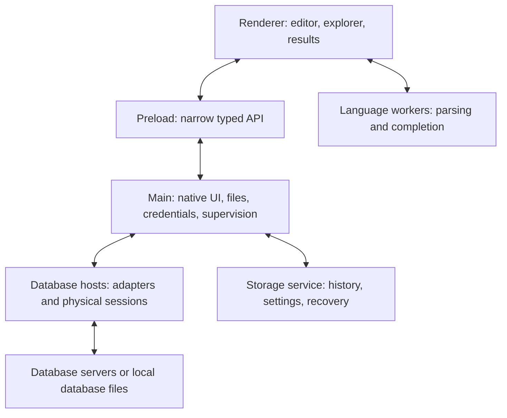

# Db Commander plan history

This file preserves the original roadmap and dated milestone reports. It is historical evidence, not the current beta backlog. Older pending-validation statements and release requirements can be superseded by later reports. Use the single [frozen beta scope and release checklist](PLAN.md) for current decisions; use [implementation](IMPLEMENTATION.md) and [validation](DRIVER_TESTING.md) for detailed evidence.

Db Commander is a local-first, open-source SQL IDE for macOS, Linux, and Windows. Build it with Electron, TypeScript, React, and database adapters that execute outside the UI process. Essential development features remain open source and usable without an account.

This is the repository version of the product and architecture plan agreed on 12 October 2026. It describes the intended product, not a claim that every feature is implemented. See [implementation status](IMPLEMENTATION.md) for the current scope. All SQL drivers must have integration tests against real engines using Docker wherever an engine can run in a container. Cloud-only services additionally require separately controlled service tests.

## 1 Product promise and releases

A programmer should be able to spend a working day connecting securely to databases; exploring schemas and relationships; writing, executing, debugging, and optimizing SQL; browsing and safely changing data; changing database objects; importing and exporting; and recovering unfinished work. The active server, database, and transaction state must remain visible.

Maintain a feature matrix with explicit release targets. Deliver a complete workflow for the primary engines before expanding into every specialized administration feature.

| Release | Intended use |
| --- | --- |
| Developer preview | PostgreSQL connection, editor, and results workflow for pilot users |
| Alpha | Core engines work; workflows and interfaces may change |
| Beta | Daily development use; feature scope substantially complete |
| 1.0 | Supported workflows pass compatibility, security, recovery, and packaging tests |
| Later | Additional engines, deeper administration, comparisons, extensions |

## 2 Database coverage

| Engine | Adapter foundation | Target |
| --- | --- | --- |
| PostgreSQL | pg with cursors and retained sessions | First implementation and 1.0 |
| MySQL | mysql2 | 1.0 |
| MariaDB | MariaDB connector and dedicated dialect/catalog handling | 1.0 |
| Microsoft SQL Server | Tedious with explicit physical session ownership | 1.0 |
| Azure SQL Database | SQL Server transport with distinct authentication and capabilities | 1.0 |
| SQLite | Isolated native SQLite adapter after cancellation and packaging prototypes | 1.0 |
| DuckDB | @duckdb/node-api | Early follow-up |
| Oracle | node-oracledb, starting with Thin mode | Follow-up |
| CockroachDB, Redshift, TiDB and compatible engines | Shared transport with distinct capability profiles and tests | Follow-up |
| ClickHouse, Snowflake, BigQuery, Trino | Dedicated execution and authentication adapters | Later |
| DB2 and less common systems | Evaluate an optional JDBC or ODBC bridge | Later |

Protocol compatibility is not a support guarantee. Catalogs, syntax, permissions, and transaction semantics differ. Publish supported engine versions, operating systems, authentication methods, and limitations. An officially supported driver needs an owner and passing contract tests.

Driver references: [PostgreSQL cursors](https://node-postgres.com/apis/cursor), [MySQL2](https://sidorares.github.io/node-mysql2/docs), [MariaDB](https://mariadb.com/docs/connectors/mariadb-connector-nodejs), [Tedious](https://tediousjs.github.io/tedious/api-connection.html), [DuckDB](https://duckdb.org/docs/current/clients/node_neo/overview), [Oracle](https://oracle.github.io/node-oracledb/).

## 3 Technology choices

| Area | Direction |
| --- | --- |
| Runtime and language | Electron and strict TypeScript |
| UI | React, accessible components, design tokens |
| Editor | Monaco with application-owned SQL intelligence |
| Grid | Prototype TanStack Table plus Virtual behind an owned interface |
| State | Zustand when shared workspace state warrants it |
| IPC | Narrow typed methods with runtime Zod validation |
| Local storage | SQLite in a storage service outside the renderer |
| Build | Vite through electron-vite; pnpm workspace |
| Packaging and updates | electron-builder and electron-updater with OS-specific policies |
| Tests | Vitest, React Testing Library, Playwright, native packaging tests |

Benchmark the grid early. Selection, clipboard operations, editing, keyboard navigation, and accessibility are substantial work. Virtualization keeps the DOM small; it does not bound loaded data. Pin compatible versions after prototypes and license review. Keep execution independent of Electron and React.

References: [electron-vite](https://electron-vite.org/guide/), [Monaco](https://github.com/microsoft/monaco-editor), [TanStack virtualization](https://tanstack.com/table/latest/docs/framework/react/guide/virtualization).

## 4 Process architecture

The renderer receives no general filesystem, shell, or credential-retrieval API. The main process manages native integration, credential access, and process lifecycles. Expensive parsing, result conversion, and database execution belong outside it.

Start database hosts lazily, normally per active connection profile, with bounded connections and idle cleanup. A host can own several sessions. Driver failure should leave the application usable. Electron [utility processes](https://www.electronjs.org/docs/latest/api/utility-process) provide isolation for responsiveness and faults, but are not automatically a sandbox for arbitrary plugins.

Use validated requests and bounded streams. Every operation needs an ID, lifecycle, cancellation path, and cleanup policy. A slow or disconnected renderer must not create an unbounded queue.

## 5 Driver capabilities and sessions

Each adapter owns configuration validation, authentication, server and capability discovery, session lifecycle, execution, cancellation, transaction operations, metadata, dialect services, generated changes, and diagnostics.

Capabilities distinguish supported, unsupported, and privilege-dependent features, including reasons. Detect them from engine, version, deployment, driver, and permissions. Preserve engine-specific metadata alongside shared fields.

Retain a physical connection per active query console. Temporary tables, variables, settings, and transactions depend on it. Use separate bounded connections for metadata and explicit additional sessions for concurrency. Opening an editor need not immediately open a connection. Reset and reconnect are explicit actions that report lost session state. PostgreSQL transactions require the [same client instance](https://node-postgres.com/features/transactions).

## 6 Execution and result correctness

Use a lifecycle of queued, running, streaming, and completed, failed, cancelled, or outcome unknown. Unknown outcomes are necessary when a connection disappears after a statement was sent. Never replay user SQL automatically.

Support current statement, selection, and scripts with ordered execution, source locations, per-statement failures, row counts, messages, timing, and multiple results. Dialect-aware statement boundaries must handle quoted strings, comments, procedure bodies, PostgreSQL dollar quotes, and SQL Server [GO batches](https://learn.microsoft.com/en-us/sql/t-sql/language-elements/sql-server-utilities-statements-go?view=sql-server-ver17). Do not split SQL using a simple semicolon expression or silently rewrite user SQL.

Bound result batches by rows and bytes, apply backpressure, and cap memory caches. Fetch very large values on demand. Show partial and truncated results explicitly. Distinguish filtering already-fetched rows from server-side filtering. Stream large exports without retaining all rows in the renderer. Display caps do not guarantee bounded database work.

The value model preserves NULL versus empty strings, exact decimals, large integers, dates, timestamps with and without time zones, binary data, and engine-specific values. Represent columns by ordinal so duplicate names survive.

Cancellation distinguishes requested from confirmed. Ending a connection loses session state and does not prove that earlier changes were undone. A late cancellation must never target the next operation on the session.

## 7 Daily-use feature matrix

| Area | 1.0 scope |
| --- | --- |
| Connections | Folders, tags, favorites, environment colors, string import, tests, timeouts, TLS certificates, SSH |
| Authentication | Passwords, supported certificates, Azure tokens, documented integrated authentication |
| Workspace | Windows, tabs, splits, recent files, restoration, unsaved recovery |
| Editor | Highlighting, formatting, autocomplete, snippets, parameters, multiple cursors, search, shortcuts, error navigation |
| Intelligence | Schemas, aliases, CTEs, columns, object navigation, function signatures |
| Execution | Statement, selection, script, multiple results, cancellation, messages, timings, transactions |
| Data browsing | Virtualization, server filters/sorting, column controls, copy/paste, foreign-key navigation |
| Data editing | Insert/update/delete, staged review, SQL preview, conflicts |
| Values | Large text, JSON, XML, hex, dates, exact numbers |
| Explorer | Tables, views, materialized views, routines, triggers, indexes, constraints, types, sequences |
| Schema changes | Common create/alter operations, routine definitions, SQL preview |
| History | Search by connection, database, date, status, SQL; favorites and retention |
| Import/export | CSV/TSV, JSON, inserts, mapping, type checks, progress and cancellation |
| Performance | Explain output for each engine; richer PostgreSQL plan visualization first |
| Accessibility | Command palette, shortcuts, themes, zoom, contrast, keyboard, screen readers |

Cache metadata for autocomplete, refresh incrementally, cancel stale requests, and avoid eagerly reading every definition. Incomplete local syntax diagnostics must not block server-valid SQL. Show connection, database/schema, target, and transaction state beside the editor and results. Use text as well as color for environments.

## 8 Safe editing and transactions

Begin grid editing with base tables having a reliable primary or unique key. Stage changes, show generated SQL, validate identity and inputs, apply parameterized changes, detect conflicts and unexpected affected-row counts, and refresh generated values.

Use optimistic concurrency through row versions or original values. Arbitrary query results remain read-only until a safe mapping to a base row is established. Joins, aggregates, duplicates, and missing keys require conservative handling.

Show autocommit/manual mode; active, failed, and unknown transaction state; commit/rollback actions; transaction age; and close/reconnect consequences. Do not promise rollback for all DDL: MySQL has [implicit-commit statements](https://dev.mysql.com/doc/refman/8.4/en/implicit-commit.html). Show irreversible operations and transaction boundaries in generated plans.

Protected profiles and broad UPDATE/DELETE warnings are usability protections, not substitutes for database permissions.

## 9 Advanced tools

Follow the core with ER diagrams, same-engine schema comparison with reviewable SQL, keyed and bounded data comparison, migration-file export, a visual query builder, session/lock inspection, wrappers around version-checked native backup tools, bulk imports with rejected-row reporting, XLSX/Parquet, and a CLI sharing the execution core.

Estimated plans and plans that execute queries must be distinct; [EXPLAIN ANALYZE executes SQL](https://www.postgresql.org/docs/current/using-explain.html). Add an extension SDK only after real adapters stabilize the interface. Treat native extensions as trusted code unless an enforceable sandbox exists.

AI assistance remains optional with explicit data-sharing controls and user-controlled execution. Defer scheduling, collaboration, synchronization, and a public extension marketplace until local workflows and trust boundaries mature.

## 10 Security and privacy

Follow [Electron security guidance](https://www.electronjs.org/docs/latest/tutorial/security): sandbox renderers, isolate contexts, disable Node integration, restrict content security policy, validate IPC senders, and control navigation and external links. Display database content as untrusted text.

Separate profile metadata from credentials. A narrow broker resolves credentials for authorized database hosts. Provide session-only secrets and OS-backed persistent protection. Detect unavailable or insecure Linux secret storage, including [safeStorage basic_text](https://www.electronjs.org/docs/latest/api/safe-storage), and decline persistent secret storage in that state.

Verify TLS by default and SSH host keys. Exclude secrets from logs and exports. Prefer external-browser interactive cloud authentication. Telemetry and diagnostic uploads are opt-in; routine logs omit SQL and results. Provide history retention and per-profile controls. Avoid persistent result caching by default. Never automatically run initialization scripts from imported profiles.

Certify integrated authentication separately on each OS. The [SQL Server driver documentation](https://tediousjs.github.io/node-mssql/) distinguishes Tedious and native trusted-connection options.

## 11 Repository and storage evolution

Start as a modular repository, then extract packages when multiple adapters justify them. The intended boundaries are desktop main/preload/renderer; core; driver API and engine adapters; SQL language services; result model; grid; storage; UI; and shared contract, integration, desktop, and performance tests.

Use SQLite for profiles, workspace state, recovery, snippets, history, preferences, and metadata cache. Apply versioned migrations, backup before destructive migrations, and explicit rejection of newer incompatible formats. Store SQL in ordinary files when practical. Shared configuration holds secret references, never secrets.

Recover buffers after renderer crashes. Restoring a workspace must never execute SQL.

## 12 Tests and performance

Each SQL driver needs a reusable Docker fixture and the shared contract tests before being shipped. Container lifecycle belongs to the test runner, with isolated projects/ports and cleanup. Add cloud-service tests separately for cloud-only behavior. Embedded engines use containerized test runners for contract coverage in addition to native packaging tests.

| Layer | Required checks |
| --- | --- |
| Unit | Lexical boundaries, quoting, parameters, types, states |
| Driver contract | Sessions, temp tables, transactions, cancellation, streaming, errors, multiple results |
| Integration | Metadata, permissions, schema changes, edits, import/export |
| Desktop | Connect, query, edit, commit/rollback, export, restart |
| Fault injection | Disconnect, restart, token expiry, worker failure, full disk |
| Security | Hostile values, IPC misuse, bad certificates, secret leakage, imported config |
| Packaging | Install, update, uninstall, native modules, credential access |
| Accessibility | Keyboard, focus, screen reader, contrast |
| Performance | Large results, wide rows, large catalogs, long sessions |

Prioritize disconnect after COMMIT, cancellation during streaming, duplicate names, precision, concurrent edits, and unsaved recovery. Run fast checks on each change, version matrices nightly, and full certification for releases. Cloud secrets never enter untrusted contributor builds. [Playwright Electron support](https://playwright.dev/docs/api/class-electron) is experimental; retain native OS and packaged-app tests.

Proposed targets on named reference hardware: roughly three-second cold launch; responsive typing during streaming; bounded ten-million-row export memory; no unbounded growth over eight hours; responsive exploration of tens of thousands of objects; immediate cancellation feedback with server confirmation tracked separately. Validate these in prototypes, not marketing claims.

## 13 Distribution

Start with macOS arm64/x64 signed and notarized DMG applications, signed Windows x64 installers, and Linux x64 AppImage/deb/rpm. Add Windows/Linux arm64 after all dependencies pass. Publish minimum OS versions based on the chosen Electron release.

The [release foundations](RELEASING.md) implement this build matrix, plus Mac ZIP archives, installer lifecycle tests and an opt-in Azure Release stage downstream of successful main desktop and Docker driver CI. Signing/notarization configuration is prepared; credentials, the Apple Silicon pool and a fully signed native run remain required. Current upgrade tests use a synthetic older version until a published release can supply a historical baseline.

Build on each OS. Use stable/preview channels, staged verified updates, and a tested recovery procedure. Never force a restart during a query or transaction. Define a package-manager versus in-app update policy for Linux. Publish checksums, SBOMs, notices, changelogs, and source revisions.

References: [code signing](https://www.electronjs.org/docs/latest/tutorial/code-signing), [updating](https://www.electron.build/docs/features/auto-update/).

## 14 Open-source maintenance

Use Apache-2.0 by default, with its explicit contributor patent grant; review all dependency and driver redistribution terms. Include contribution instructions, code of conduct, private security reporting, architecture decisions, driver ownership, issue templates, public roadmap, predictable releases, and unsupported-version policy.

Require careful review of execution, credentials, and update changes. Budget for certificates, runners, test infrastructure, release engineering, and dependency maintenance. Keep adapters internal until several implementations establish a useful stable extension API. See the [Apache license](https://www.apache.org/licenses/LICENSE-2.0).

## 15 Delivery phases

The original planning assumption is four to six experienced engineers, design support, and dedicated QA/release ownership. Budget approximately 12–18 months for broad reliable 1.0, with previews earlier; revise estimates after prototypes. Work can overlap after the execution contract stabilizes. A solo maintainer should start PostgreSQL-first; the broad scope is a multi-year effort without sustained contributors.

| Phase | Window | Exit criteria |
| --- | --- | --- |
| Architecture prototypes | 3–4 weeks | Session retention, cancellation, streaming, grid, native packaging, Azure auth proven |
| Desktop foundation | 4–6 weeks | Secure boundaries, workspace, migrations, recovery, CI, three-OS installers |
| PostgreSQL vertical slice | 8–10 weeks | Connections, explorer, editor, completion, results, transactions, cancellation, history, export usable by pilots |
| Core engine coverage | 8–12 weeks | MySQL, MariaDB, SQL Server, Azure SQL, SQLite pass contracts |
| Daily workflows | 10–14 weeks | Editing, schema tools, import, SSH, plans, accessibility, safeguards |
| Beta and hardening | 8–12 weeks | Compatibility, faults, performance, signed updates, docs, sustained pilot use |

First milestone: install Db Commander; connect to PostgreSQL using verified TLS; retain a console session; execute a script; stream bounded results; cancel work; commit and roll back edits; export data; and recover an unsaved editor after a crash. This provides the architecture and a useful application for subsequent contributors.

## Milestone update: MySQL and MariaDB

The second implementation milestone adds MySQL 8.4 and MariaDB 11.4 to the existing desktop workflow, with separate pinned client transports and shared driver contracts. The implementation includes engine selection, retained sessions, TLS, schema browsing, scripts/routines, streamed previews, cancellation, transaction status, and fetched-row export. Docker contracts run against both engines on every integration run; Electron workflows exercise both through the real bridge. See [IMPLEMENTATION.md](IMPLEMENTATION.md) for scope and [DRIVER_TESTING.md](DRIVER_TESTING.md) for reproducible checks. At that milestone, SQL Server/Azure SQL and SQLite were the next engine coverage work; the broader daily-driver roadmap above remains open.

## Milestone update: SQL Server and Azure SQL

The next implementation adds a retained-session Tedious adapter, SQL Server/Azure profiles, verified TLS, SQL-login and manually supplied Azure Entra tokens, T-SQL GO batches, bounded streaming, transaction status, ATTENTION cancellation, catalog browsing and fetched-row export. SQL Server 2022 has a TLS Docker fixture and integration contracts; both profiles have connected Electron workflows. Native x64 Ubuntu CI runs a separate SQL Server matrix job.

This milestone is **implemented but not fully validated**: the local ARM Docker daemon crashes in QEMU before SQL Server starts. The native x64 Docker suite must pass before claiming SQL Server compatibility; live Azure token/network tests remain separate. Unit tests, the connection UI, builds and previous-driver regressions can be verified here. See [verification status](IMPLEMENTATION.md) and [test instructions](DRIVER_TESTING.md). At that milestone, SQLite and the remaining daily-driver roadmap were still open; the SQLite update follows below.

## Milestone update: SQLite

SQLite now has a local-file adapter and connection UI: open existing, open read-only, create a new file without overwriting, or use a temporary in-memory database. Native SQLite parses script boundaries, including triggers; retained sessions support temporary/attached schemas, exact 64-bit integers, transactions/savepoints, bounded streamed results and fetched-row CSV export. Credentials and server settings are unnecessary.

Each SQLite connection runs in an isolated child process using Electron's bundled `node:sqlite`. Stop terminates that connection because the public Node API does not expose native query interruption; the outcome is reported conservatively and reconnect is explicit. A watchdog ends an orphaned worker even while its main thread is inside a native query. Docker runs the production adapter against real files with the matching Node/SQLite runtime, and Electron coverage exercises file dialogs, read-only behavior, cancellation and crash recovery. See [implementation status](IMPLEMENTATION.md) and [driver testing](DRIVER_TESTING.md).

This closes the planned SQLite adapter milestone within the developer-preview scope. Remaining work includes preserving SQLite sessions on cancellation, parameter prompts, SQLCipher/extensions, broader runtime/platform certification, and the shared daily-driver roadmap. The previous SQL Server/Azure validation gaps remain unchanged.

## Milestone update: Oracle Database

The next adapter adds Oracle Database to the connection dialog, retained console sessions and catalog/execution/export workflow. It uses `oracledb` Thin mode so the desktop does not require Oracle Client installation. Service-name/password connections support verified TCPS and explicit local TCP. Oracle transaction semantics remain visible: manual DML commits, savepoints, native cancellation, and implicit DDL commits, including before failing DDL.

Scripts support slash-delimited PL/SQL blocks and stored units, implicit result sets, DBMS_OUTPUT and q/nq quotes. Fetching preserves NUMBER and timestamp precision, while row/byte caps and bounded LOB reads limit previews. Oracle Free 26ai 23.26.3 provides a real Docker contract fixture on native ARM64 and x64, with generated TLS wallets, isolated test ports and cleanup. A connected Electron workflow and a separate CI matrix job cover the adapter. See [current verification](IMPLEMENTATION.md) and [reproducible tests](DRIVER_TESTING.md).

This milestone remains within the developer-preview scope. Wallet/mTLS, TNS/SID connection modes, privileged/cloud authentication, bind prompts, complex-type viewers, more server versions and the wider daily-driver roadmap remain follow-up work. Private CA trust is configured at launch with `NODE_EXTRA_CA_CERTS`; the adapter does not accept certificate-only profile wallets or bypass verification.

## Milestone update: DuckDB

DuckDB now participates in the connection, explorer, execution and export workflow using the pinned official Node Neo client and native engine. The connection dialog opens or exclusively creates local files, supports read-only access, and offers isolated in-memory databases. Retained sessions provide scripts/macros, transactions, temporary tables and attached catalogs. Previews preserve exact numeric and temporal values, apply row/byte retention limits and support session-preserving native interruption. Local CSV/Parquet analytics are available through SQL.

A Docker test runner exercises real DuckDB files through the production registry. Contracts cover parsing, transaction recovery, locks, read-only mode, precision, streaming, export, interruption and shutdown. Electron tests cover the file picker, SQL workflow, crash recovery and restart; packaged smoke tests check native addons on the target platform. The native x64 CI matrix includes a dedicated DuckDB job. See [implementation and verification](IMPLEMENTATION.md) and [test instructions](DRIVER_TESTING.md).

This is the DuckDB developer-preview milestone, not completion of the daily-driver roadmap. Read-only protects the selected catalog but permits other local file access. Extension installation is explicit by default. At that milestone, multi-console UI, parameter prompts, extension management, cloud credentials, more DuckDB versions and full release/platform certification remained follow-up work. The profiles and tabs update follows below.

## Milestone update: Saved profiles and independent query tabs

Named connection profiles can now be created, edited, deleted and reopened across all supported engines. Profiles store non-secret configuration; passwords and Azure access tokens remain session-only. The workbench supports multiple Monaco query tabs with separate physical database connections, transaction states, results, messages, schema context and cancellation. Queries run concurrently across tabs, and one tab's execution or disconnection cannot evict another tab's cached CSV results. New tabs can reuse live credentials from memory, while restored server profiles prompt again.

Workspace schema version 2 persists ordered buffers, the active tab and named profiles. Existing single-console workspaces receive a WAL-aware backup and a transactional migration preserving SQL and history. Restart and renderer recovery never reconnect or replay SQL. Tab close guards and application quit checks account for background queries and open transactions; normal quit waits for the final workspace save.

A shared two-session contract now runs in every driver's Docker suite, including separate MySQL and MariaDB transports. PostgreSQL and DuckDB desktop workflows cover concurrent tabs, transaction/temp-table isolation, cancellation, cached exports, profile lifecycle, immediate quit and crash recovery. The packaged DuckDB workflow runs alongside the existing embedded-engine smoke checks in the three-OS build matrix. See [implementation and verification](IMPLEMENTATION.md) and [test instructions](DRIVER_TESTING.md).

This completes the profiles and tabs developer-preview milestone. At that point, credential-vault persistence, SSH, profile groups, split panes, tab reordering, semantic completion, grid editing and the wider daily-driver roadmap remained open; subsequent milestone updates below track their implementation. Native SQL Server/Azure validation and release certification remain separate requirements.

## Milestone update: Schema-aware SQL autocomplete and formatting

The workbench now has schema-aware completion and explicit SQL formatting for PostgreSQL, MySQL, MariaDB, SQL Server, Azure SQL, SQLite, Oracle and DuckDB. Each tab owns a bounded, transient snapshot of tables/views and typed columns. Monaco suggestions resolve common aliases, joins, qualified names and simple CTEs without executing editor text. Dialect keywords/functions remain available offline. Metadata refresh follows connection/schema changes and has an explicit user control for external changes.

Document and selection formatting use the pinned SQL Formatter library's engine-specific dialects in a bundled Web Worker. Edits preserve case and the undo stack, keep T-SQL batch separators, and reject token-changing transformations or unsupported procedural scripts. No SQL is executed by completion or formatting. Version and session checks prevent stale work from applying to another tab.

Every driver has a Docker-backed language contract that runs generated completions and compares real results before/after formatting. The Electron workflow is parameterized over every supported connection profile; packaged DuckDB language tests run in the existing native three-OS build matrix. SQL Server/Azure still require native x64/live-service validation as documented in [IMPLEMENTATION.md](IMPLEMENTATION.md).

This milestone provides practical SQL assistance, not a full semantic compiler. Deeper query-scope analysis, stored-procedure signatures, server-session temporary metadata and formatter support for procedural bodies remain follow-up work. Later milestones cover parameters, plans, grid editing and configurable editor/whitespace-formatting preferences (runtime validation pending for the latter). See [usage and limits](../README.md) and [reproducible tests](DRIVER_TESTING.md).

## Milestone update: Editable result grids

Verified base-table editors now stage insert/update/delete operations for all eight connection profiles. Catalog metadata identifies primary/composite keys, generated/default columns and supported value types. Original snapshots stay in the database host; bound writes compare original values under locks (or DuckDB's transaction conflict detection), verify affected-row counts, and reject schema drift. Apply owns a fresh transaction on the tab's physical connection; Commit/Rollback is explicit, and a failed edit batch rolls back as a unit within the database's transactional guarantees. Drafts remain local to their tab and are guarded before execution, disconnect, close and quit.

Docker contracts exercise all production adapters and include Azure-profile coverage against the SQL Server fixture. Desktop tests cover staged changes, tab isolation, commit/rollback, conflicts, draft recovery, and execution of a selected SELECT without an unselected DELETE. SQL Server/Azure SQL remain pending native x64 validation; the other six engines pass locally. The packaged-app test now includes the DuckDB grid workflow.

The initial editor is deliberately limited to keyed base tables with supported values and a bounded preview. Arbitrary query results remain read-only. Pagination/server filters, primary-key changes, SQL change previews, binary/LOB/complex-value editors and applying within an already-open user transaction remain follow-up work. See [usage and limits](USER_GUIDE.md#edit-table-data), [implementation](IMPLEMENTATION.md#editable-grid-milestone) and [testing](DRIVER_TESTING.md#editable-result-grids).

## Additional workbench requirements (2026-10-12)

These requirements are explicitly part of the daily-driver scope and follow the editable-grid milestone:

1. **Connect at server level, then browse databases.** A database name must be optional for server profiles where the engine permits it. PostgreSQL uses a documented maintenance database for the initial connection; MySQL/MariaDB connect without a default database; SQL Server uses the login's default database or an explicitly chosen fallback. Enumerate only accessible databases in a server → database → schema → object sidebar. Selecting a database opens or switches an idle tab's physical session explicitly, preserving other tabs and refusing switches during queries, staged edits or transactions. Azure SQL database enumeration depends on the login's access to logical-server `master`; contained users may require an explicit database. Oracle still needs a service/PDB endpoint, and local SQLite/DuckDB use files and attached catalogs. Explain these engine-specific requirements in the connection dialog. Docker contracts must cover omitted database names, restricted enumeration, database selection and session isolation.
2. **Resizable and hideable workbench panels.** Add draggable, keyboard-accessible splitters for the sidebar and editor/results boundary, with usable minimum sizes. Provide View commands and shortcuts to show/hide the sidebar and results independently, a results maximize action, and Reset layout. Persist layout per workspace; recover gracefully on smaller displays and test layout changes on all desktop platforms.
3. **Optional saved connection passwords.** Provide an explicit “Remember password” control on saved server profiles, plus replace/remove actions. Resolve saved secrets through a narrow main-process broker using OS-backed protection; never store passwords or access tokens in profile JSON, SQL history, logs, or renderer recovery. Detect unavailable/insecure Linux secret storage and retain session-only behavior with a clear explanation. Deleting a profile removes its saved secret. Test restarts, changed passwords, unavailable vaults, profile deletion, and that secrets are absent from ordinary workspace records. Azure token renewal remains a separate authentication feature.
4. **Execute selected SQL. Already implemented.** Run SQL and Cmd/Ctrl+Enter execute the nonempty editor selection; with no selection they execute the script. Preserve the selected text's statement order and existing dialect parsing. Add an explicit desktop regression covering selected execution so surrounding destructive or invalid statements are never executed inadvertently. Current-statement execution and source-aware error navigation are implemented in the milestone below.

Password protection and selected execution were already in the broader plan; this update makes their acceptance criteria explicit and adds server-wide browsing and panel layout requirements.

## Database backup and restore roadmap

The advanced-tools roadmap already includes wrappers around version-checked native backup tools. Expand that into an explicit backup-and-restore workflow, separate from Db Commander workspace recovery and CSV export.

- Offer whole-database and selected-object logical backups where supported, with schema-only/data-only choices, destination selection, available format/compression options, tool discovery, version compatibility checks, progress, cancellation and diagnostic logs. Explain limitations of each engine's logical and physical formats instead of presenting interchangeable backup files.
- Restore into a new database by default. Show the source, destination server/database and proposed actions before starting; require explicit confirmation for overwrites, destructive cleanup or replacement. Validate the file/tool/engine combination and report partial or unknown outcomes without automatic replay.
- Use each database's supported backup/restore mechanisms. Treat PostgreSQL, MySQL, MariaDB, SQL Server, Oracle, SQLite and DuckDB as separate capabilities. Local-file backups must be consistent with active transactions and WAL/checkpoint behavior. Azure SQL needs a distinct workflow for supported import/export and service-managed recovery; do not imply that SQL Server native backup files can be restored directly to Azure SQL Database.
- Keep credentials out of command lines, logs and backup manifests wherever the native tool supports protected alternatives. Tell users when an artifact contains sensitive database content. Track job status across the workbench and block conflicting database switches or shutdown without an explicit decision.
- Verify with isolated Docker round trips: seed schema, relationships and representative values; back up; restore to a separate target; compare tables, constraints, exact values and row counts. Cover missing tools, incompatible/corrupt files, insufficient privileges, cancellation, existing-target protection and failed restores. Cloud-only recovery paths need separate opt-in Azure validation.

The first backup/restore milestone is implemented below. Selected-object/data-only jobs, configurable compression, existing-target restore, BACPAC/PITR and scheduled backups remain follow-up scope. Full server administration remains separate.

## Milestone update: Server browsing and safe database switching

Server profiles now accept an omitted database for PostgreSQL, MySQL, MariaDB, SQL Server and Azure SQL, with the engine-specific initial connection rules above. The sidebar shows accessible databases and the active database's schema/object hierarchy, with explicit refresh and discovery errors. Oracle service/PDB requirements and local-file workflows remain explicit.

Database selection opens a replacement physical session before retiring the original, under a host-side operation lock. Queries, table operations, non-idle transaction states and manual commit mode prevent switching; the renderer also guards staged edits. A confirmation describes temporary-object/session-setting loss. SQL buffers, saved profiles and other tabs remain intact; successful switches invalidate results and metadata, and failed target connections retain the original session.

Docker fixtures include restricted logins, inaccessible databases and a target whose name contains an apostrophe and space. A shared contract covers default connections, access filtering, state guards, failed switches and concurrent tab isolation. Electron workflows exercise the sidebar and preserved buffers, grids, profiles and results. SQL Server/Azure-profile tests are defined for native x64 CI; live Azure permissions/authentication require separate service validation. See [implementation status](IMPLEMENTATION.md#server-browsing-milestone) and [test instructions](DRIVER_TESTING.md#server-browsing-and-database-switching).

At this milestone, resizable panels, saved passwords and backup/restore remained later work. Panel layout is implemented in the milestone below.

## Milestone update: Resizable and toggleable panels

The sidebar and editor/results boundary now have draggable, keyboard-accessible dividers. Independent visibility controls appear in the header, native View menu and command palette. Results can maximize within the workbench and restore their previous height. Cmd/Ctrl+B toggles the sidebar, Cmd/Ctrl+J toggles results, Cmd/Ctrl+Shift+J maximizes/restores results, and Cmd/Ctrl+Alt+0 resets layout. Dividers support arrows, Shift+arrows, Home/End, Enter to hide, Escape to cancel a drag and double-click to reset size.

Workspace storage persists visibility, preferred sizes and maximization. Existing version 2 workspaces use defaults without migration; malformed layout data resets independently of SQL/profile recovery. Panels fit available window space while retaining preferred sizes for larger displays. Hidden panels remain mounted so layout changes preserve editor models, result state, staged edits and database work.

Desktop tests exercise pointer and keyboard resizing, native shortcuts with editor/grid focus, menu/palette/header commands, immediate-quit persistence, renderer recovery, smaller windows, virtualized results, query cancellation and transaction/draft preservation. Packaged smoke tests include these workflows in the macOS, Linux and Windows CI matrix. At this milestone, saved passwords and backup/restore remained planned. Password storage is implemented below.

## Milestone update: Optional OS credential storage

Saved server profiles now offer opt-in Remember password, replacement and explicit removal using macOS Keychain, Windows Credential Manager and persistent Linux Secret Service. The main-process broker owns credential references and binds stored values to profile identity and connection/trust settings. The renderer can request an authorized connection, but has no password retrieval API. New query tabs reuse live credentials in the main process, with independent physical sessions. Tokens remain session-only and unavailable stores never trigger plaintext or transient-keyring fallback.

Profile deletion removes its credential before discarding metadata; failed removal retains the profile for retry. Endpoint/authentication/TLS changes invalidate stored credentials. Workspace version 2 remains compatible: an optional non-secret marker tracks OS entries, including interrupted writes. Restart and renderer recovery restore profiles without reconnecting or returning secrets.

Desktop tests cover actual native store save/retrieve/use/replace/remove, application restart, renamed and changed profiles, missing secrets, unavailable/locked providers, failed writes/deletes, workspace/WAL secret absence, real PostgreSQL authentication and independent session reuse. Packaged smoke tests cover native binding distribution and credential lifecycle in the macOS/Linux/Windows CI matrix; Linux uses a disposable Secret Service instance. At this milestone, backup/restore, SSH and managed cloud-token renewal remained later work. Backup/restore is implemented below.

## Milestone update: Native database backup and restore

The workbench now offers a review-and-confirm workflow for PostgreSQL custom archives, distinct MySQL/MariaDB SQL dumps, SQL Server COPY_ONLY/checksummed server files, Oracle Data Pump schema exports, SQLite online snapshots and DuckDB native snapshots. Azure SQL has an explicit same-server database recovery-copy workflow with billed-resource confirmation, separate from file backup or managed PITR. Schema-only backups are available where implemented; restore always creates a new target.

Long-running jobs own a host-side session lock, expose progress/diagnostics and cancellation across tabs, and participate in quit protection. A bounded credential-free job journal recovers interrupted work as unknown without replay. Native client authentication uses temporary protected files rather than password arguments; local artifacts publish only after success and refuse existing destinations. Oracle compilation warnings/errors and partial server restores are surfaced for inspection.

Shared Docker contracts seed relationships, exact decimals/binary/Unicode/NULL values and views, compare a separate restored target, enforce constraints and target protection, exercise schema-only mode and cancellation, and validate malformed artifacts. Electron tests cover local and Docker server workflows, review/confirmation, transaction guards and restart recovery. Native SQL Server requires x64 CI; live Azure requires the explicit opt-in service test. See [engine scope and remaining work](BACKUP_RESTORE.md) and [test guide](DRIVER_TESTING.md#backup-and-restore).

## Milestone update: Paginated browsing, filtering and sorting

The next daily-workflow milestone, selected on 13 October 2026, adds a table/view browser for every supported connection profile. Pages are bounded at 25–200 rows and use server-side filters, native typed ordering and primary-key tie breakers. Users can combine up to eight filters with AND and three sort priorities, search literal text, distinguish NULL checks, navigate in both directions and reload. Views, keyless tables and read-only embedded files are browsable without authorizing edits. Filters and sorting are structured requests validated against current catalog columns; values remain bound parameters.

Eligible base-table pages can become editable snapshots without losing the active filters or offset. Existing original-value conflict checks, transactions, operation locks and draft guards apply to every page. Tab-local choices survive tab switching and toolbar Commit/Rollback; no table reads or filter values enter workspace recovery. Pagination uses live reads, with explicit notices for tied/unkeyed rows and concurrent changes. Keyset pagination, total counts, OR/nested filter expressions, arbitrary query-result pagination, complex-value viewers and full-result export remain later work.

Shared Docker contracts cover all adapters, including the Azure SQL profile against the SQL Server fixture, and desktop workflows exercise the real UI and IPC path. Native packaged smoke tests include DuckDB browsing. The existing main-only CI workflow is retained; development pushes do not queue builds. See [implementation and verification](IMPLEMENTATION.md#paginated-table-browsing-milestone).

## Milestone update: Data import and full-result export

Data transfer now uses cancellable, session-owned jobs for all eight connection profiles. CSV/TSV imports preview UTF-8 files, map or skip source columns, validate current table metadata and scalar values, and append with bound parameters. The importer does not require a primary key. It refuses generated-column assignments, honors omitted-column defaults, and detects source/schema changes. It rolls back the batch on parse, constraint, conversion or cancellation errors; success leaves the transaction open for explicit Commit or Rollback.

Full-result CSV, TSV and JSON exports explicitly execute one reviewed SELECT/CTE query, using the editor selection when present. Native cursor/stream paths apply file backpressure without keeping exported rows in the renderer or preview cache. The preview limits remain unchanged. Completed files publish atomically without replacing existing destinations; failure and cancellation do not publish partial exports. The UI distinguishes NULL and empty strings and documents exact-value JSON encoding.

Shared Docker contracts cover every adapter and the Azure SQL profile against the SQL Server fixture. Desktop tests cover mapping, defaults, transaction decisions, full exports beyond the preview, selection-only export, existing-file protection and cancellation. Packaged smoke tests include the DuckDB transfer workflow. See [implementation and limits](IMPLEMENTATION.md#data-import-and-full-result-export) and [reproduction commands](DRIVER_TESTING.md#data-import-and-full-result-export).

Db Commander JSON import and SQL INSERT export are implemented in milestones below; INSERT runtime validation is deferred. Other JSON layouts, XLSX/Parquet interfaces, resumable/native bulk loading, continue-on-error reject files and configurable encodings/dialects remain follow-up work. The current importer fails atomically and identifies the failing record.

### Suggested order for subsequent daily-use milestones

1. **Implemented:** expand schema exploration to indexes, keys, constraints, routines, triggers, sequences and object definitions/DDL (scope below).
2. **Implemented:** add common schema creation/alteration workflows with reviewable SQL and engine-specific transaction boundaries (scope below).
3. **Implemented:** add SSH tunnels, profile folders/favorites, environment labels and protected production profiles (scope below).
4. **Implemented:** engine-specific EXPLAIN support and visual PostgreSQL query plans (scope below).
5. **Implemented:** large-value/JSON/XML/hex inspection, column controls and foreign-key navigation (scope below).
6. **Implemented:** searchable history, retention, favorites, snippets and bound query parameters (scope below).
7. **Implemented:** ER diagrams with table selection, ordered foreign keys, layout controls and SVG export (scope below).
8. **Implemented:** bounded same-engine schema comparison with reviewable SQL and database/table context menus (scope below).
9. **Implemented:** keyed, bounded same-engine table data comparison with filtered scopes and JSON reports (scope below).
10. **Implemented:** migration-file export from reviewed guided schema changes and selected schema-comparison suggestions (scope below).
11. **Implemented:** schema-aware visual SELECT builder with joins, aggregates, bound predicates, SQL review and independent query tabs (scope below).
12. **Implemented:** read-only session and lock inspection, with engine-specific visibility, blocking relationships and explicit report export (scope below).
13. **Implemented:** reviewed session cancellation and termination with short-lived single-use reviews, native identity revalidation and engine-specific impact handling (scope below).

ER diagrams, bounded same-engine schema/data comparison, migration-file export, parameterized full-result export, parameterized EXPLAIN, snippet import/export, decimal/date/timestamp parameters, timezone-aware timestamp parameters and typed array parameters are implemented below. Multidimensional arrays, table-valued/collection parameters and other engine-specific parameter types remain follow-up work.

## Milestone update: Rich schema exploration and object definitions

The sidebar now groups and filters catalog objects by kind, with a Details action alongside existing table browsing/editing. On-demand inspection shows columns/defaults, indexes, keys, foreign-key targets, constraints, triggers, routine parameters and sequence configuration where exposed by the engine. PostgreSQL overloads retain distinct identities and signatures. Oracle materialized views are distinguished from their backing tables. SQLite/DuckDB inspection includes the current session's temporary objects and attached catalogs.

The definition viewer supports refresh, copy, save and opening SQL in a new query tab with a separate session. These actions never execute the definition or replace the original SQL buffer. Native metadata, generated structural summaries, unavailable definitions and truncation are explicit. Definitions are not complete migration scripts or backups. Server catalog connections preserve the original transaction; embedded reads use the original session to see its local objects.

Docker contracts cover quoted identifiers, tables/views/materialized views, indexes, keys and foreign keys, routines/macros, triggers, sequences, refresh after DDL, removed/forged identities, PostgreSQL restricted visibility, and transaction/temporary-object isolation. SQL Server/Azure-profile tests additionally cover encrypted definitions on the Linux x64 fixture. Desktop and packaged workflows exercise the real UI, IPC, clipboard/file actions and buffer/transaction preservation. Main-only CI remains unchanged.

Common schema editing is covered by the following milestone. ER diagrams, dependency graphs, catalog pagination, cross-schema Oracle browsing, broader custom-type catalogs and complete recreation/migration scripting remain follow-up scope. See [engine-specific scope and verification](IMPLEMENTATION.md#rich-schema-exploration-and-object-definitions).

## Milestone update: Schema creation and alteration

The guided schema editor supports table creation with typed columns, literal defaults and primary keys; adding/renaming/dropping columns; renaming/dropping tables; ordinary/unique index creation and index removal. PostgreSQL, SQL Server/Azure SQL and DuckDB can create namespaces. Other engines use existing database/user/attachment namespaces rather than silently creating databases or accounts.

The database host generates and retains a session-bound, expiring review. Apply accepts the plan ID and explicit acknowledgments, rechecks object identity and metadata, and executes only the reviewed statements. Editing the form invalidates its review. The SQL buffer and fetched results remain intact; submitted statements are recorded in query history. Copy/save does not execute SQL.

Transactional engines start a new transaction and leave success for explicit Commit/Rollback. Failure/cancellation rolls back the owned transaction when confirmed. MySQL, MariaDB and Oracle require an idle session and acknowledgment of implicit commits. Active transactions, unresolved grid drafts, concurrent operations and stale reviews are blocked. Cancellation and connection loss never cause automatic retries; uncertain outcomes are reported explicitly. Catalog refresh follows commit/rollback so separate metadata connections do not block on the tab’s own DDL locks.

Docker contracts and desktop workflows cover review-only behavior, real schema changes, rollback versus implicit commits, destructive confirmations, stale metadata, permission errors, result/buffer preservation, and lock cancellation. SQL Server/Azure-profile coverage remains assigned to native Linux x64; main-only CI is unchanged. See [implementation and verification](IMPLEMENTATION.md#schema-creation-and-alteration) and [test commands](DRIVER_TESTING.md#schema-creation-and-alteration).

Existing-column type/default/nullability changes, foreign/check/unique constraint designers, view/routine editing forms, identity/generated columns, dependency rewrites and full migration/table-rebuild planning remain follow-up scope. The SQL console remains available for those operations. SSH tunnels and connection organization/protection are covered below.

## Milestone update: SSH tunnels and profile organization

Server connections can use a managed SSH tunnel with pinned SHA256 host-key verification, password or encrypted private-key authentication, or an existing SSH agent. Each tab owns its tunnel, metadata/cancellation traffic follows it, and database TLS retains the configured server identity. Database switches establish a replacement tunnel before retiring the previous session. Disconnects and failed connections release forwarding resources; tunnel loss reports uncertain work without reconnecting or replaying SQL.

Saved profiles support named collapsible folders, favorites/filtering, development/test/staging/production labels and optional protection. Production always enables protection. Protected sessions start locked, permit browsing, and require a typed connection-name acknowledgment for ten minutes of SQL execution and guided changes. The database host enforces the guard for console SQL, grid writes, schema application, transfers, restore and Azure recovery-copy creation. Exact COMMIT/ROLLBACK remain available after relocking. Unlocks are per-session and never persisted or copied into another tab/database.

Docker contracts use a disposable OpenSSH bastion and all database adapters. Desktop workflows cover profile organization, persisted settings, SSH verification, protection and independent tabs. Packaged smoke tests include the DuckDB profile workflow. Main-only CI remains unchanged. See [implementation and verification](IMPLEMENTATION.md#ssh-tunnels-and-profile-organization) and [test commands](DRIVER_TESTING.md#ssh-and-protected-profiles).

Follow-up scope includes nested folder management, arbitrary environment tags, SSH config/known_hosts import, jump chains, keyboard-interactive/MFA authentication, persistent SSH-secret storage and native MySQL/MariaDB backup tools through managed tunnels. Oracle SSH requires TLS; redirected Oracle/Azure endpoints require a fixed endpoint (Azure Proxy policy). These safeguards prevent accidental actions; database permissions remain the authorization boundary. Query plans are covered below.

## Milestone update: Query plans

The Explain action captures one selected statement, or a single-statement buffer, using native estimated plans for all eight profiles. PostgreSQL/MySQL/MariaDB return JSON, SQL Server/Azure SQL return Showplan XML, Oracle returns DBMS_XPLAN text, SQLite returns EXPLAIN QUERY PLAN rows and DuckDB returns its native plan text. SQL Server/Azure queries currently accept SELECT/WITH. Native permissions and unsupported statement/version errors are surfaced without executing a fallback query.

PostgreSQL plans have an expandable tree, cost bars, row estimates, selectable operator details and raw output. Explicitly confirmed EXPLAIN ANALYZE adds actual rows, loops, timings and buffers; it executes the SQL under the existing tab's transaction rules without automatic rollback. Estimated and actual captures are labeled and dated. Existing editor text, result rows and cached exports are retained. Plans can be copied or saved, cancelled and reopened in the originating tab; no execution is restored after restart.

SQL Server and Oracle use disposable planning connections to isolate SHOWPLAN and PLAN_TABLE state. Other engines use the tab's physical session. Protected sessions must be unlocked for either mode. Docker and desktop tests cover native output, transactions, SSH, selected SQL, cancellation, persistence boundaries and prior-result preservation. Main-only CI remains unchanged. See [scope and verification](IMPLEMENTATION.md#query-plans) and [test commands](DRIVER_TESTING.md#query-plans).

Follow-up scope includes actual plans for engines other than PostgreSQL, SQL Server DML/batch planning, imported/comparable plans, persisted plan history, additional visualizers and graphical plan export. Value inspection and navigation are covered below.

## Milestone update: Value inspection and foreign-key navigation

Result and table cells have read-only text, precision-preserving JSON, XML structure/raw text and paged hex inspectors. Query-result inspection uses captured data without re-execution; table inspection can explicitly load a bounded current value by a validated, non-null primary key. Unsupported/keyless values retain honest snapshot/placeholder limitations. Copy/save exports the displayed representation. DTD/entity processing, arbitrary HTML rendering and binary decoding guesses are excluded.

Columns can be hidden, reordered, pinned and resized through width controls. Settings are independent per tab and table/result, survive table paging and remain in memory only. Hidden/reordered columns keep their original mutation identities, and CSV export keeps the original fetched order.

Foreign-key navigation uses native ordered metadata from every adapter, supports composite keys, binds captured source values and opens a filtered read-only parent page. The host accepts retained snapshot/row/reference identities rather than renderer-provided target SQL. NULL, incomplete, stale or unrepresentable keys fail explicitly. Back navigation reopens the previous table/page/filter state. Busy sessions, unresolved transactions and staged edits block navigation; no query buffer or cached query result is replaced.

Docker contracts and real Electron desktop workflows cover all engine profiles, with SQL Server/Azure-profile runtime checks assigned to Linux x64. Main-only CI remains unchanged. See [implementation and verification](IMPLEMENTATION.md#value-inspection-column-controls-and-foreign-key-navigation) and [test commands](DRIVER_TESTING.md#value-inspection-and-navigation).

Follow-up scope includes streaming arbitrary-length LOBs, direct binary-file export, editable structured values, reverse child-row navigation, arbitrary-query column lineage and persisted column layouts. Direct drag/keyboard resizing and bounded automatic sizing are implemented below with runtime validation pending. Searchable history, retention, favorites, snippets and bound query parameters are implemented in the next update below.

## Milestone update: Query library and bound parameters

The query library now provides paginated SQL search, connection/database/engine/status/UTC date filters, history favorites, individual deletion and explicit clear controls. Retention settings control global recording, age/count limits and favorite exemptions; profiles can disable recording independently. Named snippets support descriptions, engine labels, favorites and search. Opening history or snippets creates a new tab and never executes SQL. Existing history migrates with a readable backup.

The editor accepts portable `:name` value parameters for one SELECT/WITH/INSERT/UPDATE/DELETE statement, including selected SQL. The prompt offers text, exact signed 64-bit integers, booleans, NULL and hex bytes. Every adapter uses native binding with lexical marker translation, preserving streaming, cancellation and per-tab transactions. Formatting preserves markers. History saves names/types only; bound values and result rows remain transient. Scripts, identifiers, procedural bindings and native placeholder syntaxes are outside this prompt's scope.

Shared Docker contracts cover all eight profiles, including SQL Server/Azure profiles in the Linux x64 suite. Desktop tests cover execution, selection, validation, search/pagination, favorites, snippets, retention, recording controls, restart and absence of bound values from persistence. Packaged smoke tests include the DuckDB library workflow. See [implementation and verification](IMPLEMENTATION.md#query-library-and-bound-parameters).

## ER diagram milestone

Implemented interactive ER diagrams for all eight connection profiles. The explorer opens a bounded catalog-backed graph of base tables with column types, primary keys and ordered foreign-key mappings. Composite keys, self-references, duplicate table names in different schemas/catalogs, and multiple relationships are represented explicitly. Users choose tables, add visible referenced tables, search, inspect mappings, rearrange nodes, pan/zoom, fit, toggle columns and export inert SVG through a native save dialog.

Metadata visibility and session scope follow each adapter's catalog behavior; partial results, inaccessible targets and truncation are labeled. Diagram reads preserve query state and do not execute user SQL, fetch table rows or authorize writes on protected profiles. Docker contracts cover every adapter, including Azure-profile routing against the SQL Server fixture; desktop workflows and the packaged DuckDB smoke suite cover the viewer. SQL Server/Azure runtime checks require native Linux x64. Main-only CI is unchanged.

Schema comparison follows below. Keyed/bounded data comparison follows below; migration-file export is implemented below. Persistent diagram layouts, view lineage, relationship enforcement/cardinality annotations, PNG/PDF and offline diagram files are follow-up work. See [implementation and verification](IMPLEMENTATION.md#er-diagrams) and [test commands](DRIVER_TESTING.md#er-diagrams).

## Same-engine schema comparison milestone

Implemented a read-only comparison across connected tabs/namespaces for all eight connection profiles, using the existing engine-specific catalog adapters. The comparison matches kind/name/parent/overload, ignores physical object IDs and fetch times, and labels missing, changed, matching and unknown objects. Scope is bounded to 40 objects per side and 4 MB of retained metadata. Both sessions are reserved during collection, transactions must be idle, and query buffers, histories, results and protection state remain intact.

Users review both definitions/metadata, filter and select differences, copy/save the SQL review, or open it in a fresh target-connected query tab. SQL suggestions cover missing nullable scalar columns with fully represented catalog types; destructive table drops are opt-in. Other DDL is provided as commented reference SQL for manual editing. There is no automatic application, namespace rewriting, inferred rename, dependency ordering or claim of full schema equivalence. This deliberately leaves complete migration generation, semantic SQL normalization and broader column conversion support for future work.

Database context menus expose backup/restore, comparison and schema tools. Table context menus expose Details, Browse, Edit and Alter, replacing repeated row buttons. Right-click and Shift+F10/Menu, keyboard navigation, dismissal and window-edge positioning are supported. Existing operation, transaction and staged-edit safeguards remain in place.

Keyed/bounded data comparison follows below; migration-file export is implemented below. See [implementation](IMPLEMENTATION.md#same-engine-schema-comparison-and-explorer-context-menus) and [test commands](DRIVER_TESTING.md#schema-comparison-and-context-menus).

## Keyed and bounded data comparison milestone

Implemented read-only table comparison across connected tabs for all eight connection profiles. Source and target use the identical engine/profile type. A declared primary key is the default; explicit composite keys are checked for NULLs and duplicate captured values. Users select matching column names/types, bound filters for each side and up to 200 rows per side. The complete filtered sets must fit the limit before any differences are returned. Captures reject oversized values/data, unsupported selected types and table-definition drift.

The dialog shows row counts and source-only/target-only/changed/matching results, changed-cell details, display filters/search, 25-row display pages and explicit JSON report saving. Both sessions remain reserved during reads, with idle transaction requirements and existing protected/read-only access. Comparison preserves query results, history, buffers and editable-grid originals; captured values are not persisted automatically.

This is not data synchronization or a consistent cross-database snapshot. Cross-engine comparisons, column remapping, semantic JSON/numeric/collation normalization, binary/LOB comparison, larger streaming comparisons, comparison cancellation and generated DML remain follow-up work. Migration-file export follows below. See [implementation](IMPLEMENTATION.md#keyed-and-bounded-data-comparison) and [tests](DRIVER_TESTING.md#keyed-data-comparison).

## Migration-file export milestone

Guided schema reviews and same-engine comparison suggestions now export timestamped, named UTF-8 `.sql` files through a separate file review. The utility process retains canonical generated statements; the renderer selects changes and options, then reviews the exact preview and SHA-256 checksum. Saving is explicit, never applies SQL, and never replaces an existing migration. Metadata is commented line by line, destructive SQL needs acknowledgment, edits invalidate the preview, and expired/disconnected reviews must be prepared again.

Transaction handling defaults to the caller. PostgreSQL, SQL Server/Azure SQL, SQLite and DuckDB optionally add native BEGIN and COMMIT; MySQL, MariaDB and Oracle retain implicit-commit warnings without wrappers. Exported files require a suitable runner that stops on errors; no automatic rollback behavior is claimed. Comparison exports are partial suggestions, with unsupported/reference-only selections rejected and manual dependency work called out.

Docker contracts execute exported create/alter/drop and comparison migrations against native engines. Desktop workflows verify preview invalidation, confirmations, cancellation, exact saved contents, overwrite refusal, preserved source tabs and narrow-window layouts. See [implementation](IMPLEMENTATION.md#migration-file-export) and [test commands](DRIVER_TESTING.md#migration-file-export).

The visual query builder follows below. Automatic migration execution/ledgers, down migrations, framework-specific formats, dependency ordering, complete schema recreation and arbitrary edited-SQL migration authoring remain follow-up work.

## Visual query builder milestone

Implemented a schema-aware SELECT designer for all eight profiles. Users select visible tables/views, add INNER/LEFT joins with ordered equality keys, choose output columns and aliases, add aggregates, WHERE/HAVING predicates, sorting, DISTINCT and an engine-specific row limit. Self joins and composite joins are supported. Non-aggregate outputs form GROUP BY automatically. Named value parameters use the existing native binding dialog when the generated SQL is deliberately executed.

The builder opens from table/view and current-database context menus or Commands. Review reserves the source session and refreshes metadata before resolving every table/column and generating quoted SQL. It requires an idle transaction and complete schema metadata. Review, copy, save and opening an independent query tab never execute the SELECT or replace the original tab's SQL/results/history. Changing the design or refreshing the schema invalidates the preview.

Docker contracts exercise generated SQL for every profile; desktop workflows cover editing, review invalidation, native file/clipboard actions, parameter execution and independent sessions. Existing Docker images are reused locally. SQL Server/Azure-profile runtime tests remain assigned to native Linux x64; CI remains main-only.

This bounded designer supports five sources, 32 outputs, 16 WHERE predicates, eight HAVING predicates, eight sort keys and at most 1,000 returned rows. Raw expressions, nested predicates, subqueries/CTEs/unions, DML design, FK auto-joins, persistent visual designs and SQL-to-design round trips remain follow-up work. Save ordinary generated SQL to retain a query. Session and lock inspection follows below. See [implementation](IMPLEMENTATION.md#visual-query-builder) and [tests](DRIVER_TESTING.md#visual-query-builder).

## Session and lock inspection milestone

Implemented read-only, manual activity snapshots from the current database menu and Commands. PostgreSQL, MySQL, MariaDB, SQL Server/Azure SQL and Oracle expose bounded session, lock and blocking-relationship sections through independent observer connections. SQLite/DuckDB expose local application connections and last-known transaction state, with unsupported lock/owner visibility called out. Running queries and open transactions can be inspected without replacing results, adding history, settling transactions or unlocking protected profiles.

Users filter/page captured rows, inspect session details, follow blocker/waiter IDs, view a selected session's locks and explicitly save JSON reports. SQL text is opt-in and never captured automatically. Missing privileges, native visibility limits, truncation and stale/non-atomic reads are explicit; a missing blocker is not treated as a nonexistent blocker. Limits are 200 sessions, 500 locks, 500 blocking relationships and 4,000 characters of SQL per session, with engine-side truncation still possible.

Docker tests cover real blocked transactions and their resolution, ordinary versus monitoring privileges, preserved caches/transaction state, protected observers and embedded-engine scope. Desktop tests exercise native inspection, privacy, navigation, refresh, file actions and preserved buffers/results. Existing Docker images are reused locally; native SQL Server/Azure-profile validation remains assigned to Linux x64, and main-only CI is unchanged.

Cross-instance/cloud-wide monitoring, automatic polling/history, OS lock probing, deadlock history and complete metadata/advisory-lock coverage remain follow-up work. Existing Stop/Commit/Rollback controls continue to operate on the owning query tab. Reviewed administration follows below. See [implementation](IMPLEMENTATION.md#session-and-lock-inspection) and [tests](DRIVER_TESTING.md#session-and-lock-inspection).

## Reviewed session cancellation and termination milestone

Implemented separate reviews from selected sessions in the inspector. Reviews show the issuing connection, target user/database/client, native identity, transaction marker, command and engine-specific impact. They expire after 60 seconds and require explicit acknowledgment plus an exact typed confirmation. Host-retained commands and identities are single use, source-bound, invalidated on refresh/disconnect/replacement and revalidated immediately before dispatch. Missing identities, changed transactions/statements, protected profiles and stale reviews fail without sending an administrative command.

PostgreSQL, MySQL, MariaDB and Oracle support statement cancellation and session termination. SQL Server/Azure SQL support remote termination; query-only cancellation stays in the owning tab. SQLite/DuckDB expose no server administration controls; their existing owning-tab controls remain available. Native permissions apply without privilege elevation. Results distinguish a requested action, refusal, disappeared target and unknown outcome; no automatic retry, reconnect or replay occurs. Accepted requests do not guarantee that rollback or cleanup has finished.

Docker contracts cover real blocked statements, permission rejection, protected issuing/target profiles, stale query reviews, replay refusal, termination rollback and preserved source state. Desktop workflows cover explicit review/confirmation, nested-dialog dismissal, stale errors and real native actions. Existing images are reused; SQL Server/Azure-profile execution remains assigned to native Linux x64, with main-only CI unchanged. Remaining administration work includes external audit integration, broader cluster/cloud scopes and engine-specific operational dashboards. See [implementation](IMPLEMENTATION.md#reviewed-session-cancellation-and-termination) and [tests](DRIVER_TESTING.md#reviewed-session-controls).

## Rollback-progress inspection milestone

Implemented manual rollback diagnostics from selected sessions and automatic capture before reviewed cancellation/termination. Refresh follows a captured transaction identity rather than attaching to a new transaction on the same session ID. Captures remain in memory, expire after 30 minutes, and are cleared on disconnect/database replacement. Diagnostics use independent, bounded observers and remain available for locked production profiles without changing their protection, console transaction, results or history.

Native evidence is labeled by engine: SQL Server/Azure SQL rollback-request percentage; Oracle undo usage and optional parallel recovery counters/percentage; MySQL/MariaDB InnoDB state and counters; PostgreSQL transaction/session visibility. SQLite/DuckDB expose an explicit unsupported result. Missing/hidden rows never imply completion. No automatic polling, repeated control command, invented percentage/ETA, or silent retargeting occurs. Cancellation can leave a transaction and locks open; inspection follows that transaction, not an individual statement’s undo.

Docker and desktop contracts cover read-only observation, missing permissions, transaction replacement, post-termination inspection and retained editor state, using existing images. Native SQL Server/Azure-profile execution remains assigned to Linux x64. Remaining administration work includes durable/external audit integration, cluster-wide and cloud recovery scopes, and operational dashboards. See [implementation](IMPLEMENTATION.md#rollback-progress-inspection) and [testing](DRIVER_TESTING.md#rollback-progress-inspection).

## Safe SQL file handling milestone

Implemented file-associated query tabs, Save/Save As, native shortcuts and File actions, explicit discard/save protection when closing tabs, and quit choices for unsaved file edits. Recovered buffers retain their file associations and saved-content fingerprints without reconnecting or executing SQL. Opening an already-open file focuses its existing buffer. Files open in new disconnected tabs so existing session and transaction state remain intact.

Recent files retain up to 20 paths and can be cleared independently. External edits, replacements, deletion and unreadable files are detected on focus and periodic checks; no automatic buffer replacement occurs. Reloading dirty buffers requires confirmation. Saves use adjacent temporary files, an atomic replacement, disk-revision revalidation and explicit conflict review; failures/cancellation keep editor text. Existing UTF-8 BOM and newline conventions are retained. Engine-specific SQL exports remain separate from tab Save.

Desktop coverage includes native shortcuts/dialogs, duplicate opens, Save As, cancelled/failed saves, close protection, multi-file quit/recovery, external-edit races, reload, missing/invalid files, recent-history clearing and retained database transactions/results. The packaged desktop suite includes these workflows on each configured OS target; development CI remains disabled. OS file-manager associations, drag-and-drop, non-UTF-8 conversion, multi-process file locking and automatic disk autosave remain follow-up work. See [implementation and test commands](IMPLEMENTATION.md#safe-sql-file-handling).

## Developer UI simplification

The main workspace now uses direct labels and status messages, with no slogans or decorative empty-state panels. Run, Stop, Format and transaction controls stay visible. Query tools groups EXPLAIN, the query builder, import/export and the query library; Commands supports text search and keyboard navigation. The sidebar prioritizes connections and database objects, with compact favorites, expandable catalog information and schema/diagram actions in the database menu.

Connection dialogs show server/file settings first, keep Connect and Cancel visible, and put profile organization, history settings and SSH configuration in expandable sections. Existing profile settings open when relevant. Errors, truncation notices, transaction state and production safeguards remain visible. See [implementation](IMPLEMENTATION.md#developer-ui-simplification).

## Table object collections

The explorer nests indexes, keys, constraints and triggers beneath their owning tables (and views where supported). Tables and collections start collapsed. Keys includes primary keys, foreign keys and unique constraints; other constraints remain separate. Search and kind filters retain the owning table and reveal matching children. Table context menus and SQL previews are unchanged.

Oracle catalog rows now include index/trigger parents, and SQLite foreign keys appear as individual entries using SQLite's numeric IDs. Namespace matching includes catalog and schema; objects whose owners are absent from bounded metadata remain accessible in collapsed schema collections. See [implementation](IMPLEMENTATION.md#table-object-collections).

## Current-statement execution and error navigation milestone

Implemented **Run current statement** (`Cmd/Ctrl+Shift+Enter`), **Run current batch** for SQL Server/Azure SQL, and **Run entire script** in Query tools and Commands. Run SQL/`Cmd/Ctrl+Enter` retains selection-or-script execution. Current execution uses the cursor, preserves the tab's connection and transaction, and supports the existing bound-parameter prompt. T-SQL executes a complete GO-delimited batch once, preserving variables; explicit script execution retains GO repeat counts.

Statement boundaries reuse network-driver parsers for quotes, comments, PostgreSQL dollar-quoted bodies, Oracle PL/SQL and MySQL/MariaDB DELIMITER blocks. SQLite tracks complete trigger bodies; native SQLite/DuckDB preflight also rejects multiple execution units in a current request. Unsupported/ambiguous routine forms are refused rather than selecting an inner statement.

Failed executions expose a button selecting the failed statement/batch in its original buffer, including selection offsets. Unknown parser/parameter-rewrite locations select the submitted SQL with an explicit label. Links are disabled after buffer changes, isolated by tab/session/query identity, and never execute SQL. Exact native error columns and stored-procedure body navigation remain follow-up work. See [implementation](IMPLEMENTATION.md#current-statement-execution-and-error-navigation).

## Milestone update: Parameterized full-result export

Full-result CSV/TSV/JSON export now accepts the existing portable `:name` parameters for all eight connection profiles. After reviewing SQL and destination, users enter typed values in a separate prompt and explicitly export. Bindings are validated before a job starts, remain native values through each adapter, and are never interpolated into SQL. The captured query, destination, format and session stay fixed while the prompt is open. Cancel runs nothing; each new export starts with fresh values.

Existing session/transaction/protected-profile guards, streaming backpressure, preview-cache preservation, cancellation and no-overwrite publication still apply. Parameter values are not stored in jobs, history or workspace recovery. Native failure diagnostics for parameterized exports are omitted because they can echo values; exported rows can intentionally contain those values. Standalone PostgreSQL/MySQL/MariaDB Hex parameters now receive binary SQL types instead of ambiguous text inference.

Shared Docker contracts exercise all profiles, with SQL Server/Azure assigned to native Linux x64. Desktop coverage verifies review, cancel, validation, full export beyond the preview limit, retained editor/results, nested Escape behavior and absence of values from persisted workspace/history. Cached Docker images are reused. Parameterized EXPLAIN is covered by the following milestone; no pipeline or release-policy change is included.

## Milestone update: Parameterized EXPLAIN and editor actions

EXPLAIN accepts portable `:name` bindings for all eight connection profiles, using the existing Text, Integer, Boolean, NULL and Hex prompt. Values are validated before execution, are never pasted into SQL, and are requested anew for every plan. PostgreSQL ANALYZE still needs explicit confirmation and follows the tab's transaction state. SQL Server/Azure SQL and Oracle retain private plan connections. Oracle estimates do not peek at bind values and may differ from the actual execution plan.

Captured plans remain in tab memory and may include values. History records submitted SQL with native placeholders and parameter names/types; workspace recovery never stores parameter values or plans. Parameterized server diagnostics are hidden because they may echo values. Output can still be explicitly copied/saved. Cancellation, protected profiles, result retention, SQL-mode parsing and plan-size limits remain enforced.

The SQL editor now supports **Run selected SQL** and **Run current statement / batch** from its right-click menu. Selection execution uses the existing parameter and transaction workflow and preserves the editor buffer. Actions are unavailable while execution is blocked or the tab is disconnected. Sidebar history entries now include the execution date and local time.

Docker contracts cover binding types, repeated names, preflight refusals, transactions, cancellation and privacy. Desktop tests cover prompt cancellation/validation, fresh values, ANALYZE confirmation, selected-range execution, dated history and persistence. Existing images are reused; SQL Server/Azure runtime checks require native Linux x64. See [implementation](IMPLEMENTATION.md#parameterized-explain-and-editor-actions).

## Milestone update: Snippet import and export

The Query library supports exporting one saved snippet or the filtered list to a versioned UTF-8 JSON file. Names, SQL, descriptions, engine labels and favorites are portable; local IDs/timestamps, connection profiles, history, unsaved edits and bound values are excluded. Existing output files are never replaced.

Import presents a captured SQL preview with per-entry selection and duplicate choices: skip matching names/engines or keep renamed copies. Names compare after Unicode normalization and lowercasing within the same engine; no existing snippet is overwritten. Confirmation atomically saves the batch with new local IDs. Malformed/unsupported files, changed-library reviews, expired reviews and storage-limit failures leave the library intact. Import/export never executes SQL or changes sessions, results or transactions.

Files are limited to 32 MiB, 200 entries and 5,000,000 SQL characters, retaining the 100,000-character per-snippet limit. Reviews expire after ten minutes. The format is Db Commander JSON; other IDE formats, merge/replace policies and folder sharing are follow-up scope. Docker contracts exercise imported SQL through all adapters, including an Azure-profile case; desktop tests cover native dialogs, review, selection, duplicates, unsaved edits, restart and explicit bound execution. Existing Docker images are reused. See [implementation](IMPLEMENTATION.md#snippet-import-and-export).

## Milestone update: Decimal, date and timestamp parameters

The shared parameter prompt now offers Decimal, Date and Timestamp for ordinary execution, selected/current statements, full-result export and EXPLAIN. Validation runs again in the host before reserving a session, creating an export job or executing SQL. Decimals remain strings with up to 38 digits of precision and 30 fractional digits; timestamps preserve six fractional digits and calendar fields without timezone conversion. Dates use Gregorian years 1000–9999. Exponents, invalid dates, timezone offsets and unsupported precision are refused explicitly.

Every adapter binds values through its native parameter path with generated engine conversions. Oracle uses explicit numeric and temporal format models. SQLite preserves these values as TEXT, with an explanation of numeric-affinity limitations in the prompt. Bound values remain transient; history records names/types, and plans/exported data may intentionally include values. Existing transaction, cancellation and protected-profile behavior applies.

Docker and desktop contracts cover all eight profiles, including an Azure profile on the SQL Server fixture. They verify exact values, non-UTC sessions, fractional precision, repeated parameters, INSERT/UPDATE/rollback, preflight refusal, export, plans and persistence privacy. Existing Docker images are reused; native SQL Server/Azure runtime tests require Linux x64. Timezone-aware timestamps are added in the next milestone below. Typed arrays are covered by the later array milestone; OUT parameters and parameterized scripts remain follow-up work. See [implementation](IMPLEMENTATION.md#decimal-date-and-timestamp-parameters).

## Milestone update: Timezone-aware timestamp parameters

The parameter prompt now includes Timestamp with timezone (`timestamptz`) for execution, full-result export and EXPLAIN. It requires an explicit `Z` or fixed offset up to ±14:00, validates both local and UTC Gregorian dates within years 1000–9999, and normalizes to UTC without losing any of the six fractional digits. Original offsets are not retained. Named regions and daylight-saving inference are intentionally excluded; ambiguous or invalid input fails before a query, plan or export job starts.

Native timezone types are used on PostgreSQL, SQL Server/Azure SQL, Oracle and DuckDB. MySQL/MariaDB bind UTC DATETIME(6), with a prompt explaining session-timezone conversion when assigning to TIMESTAMP columns. SQLite uses canonical UTC TEXT. Existing values remain transient; history retains only names/types, while query results, exports and plans can contain values.

Docker contracts and desktop workflows cover every profile, including SQL Server and Azure cases for native Linux x64 CI. Coverage includes offset equivalence, DST overlaps, calendar rollover, microseconds, range checks, INSERT/UPDATE/rollback, repeated binds, retained results, export, EXPLAIN and persistence privacy. Cached Docker images are reused. See [implementation](IMPLEMENTATION.md#timezone-aware-timestamp-parameters).

## Milestone update: Array query parameters

The shared parameter prompt accepts one-dimensional typed JSON arrays for Text, Integer, Decimal, Date, Timestamp, Timestamp with timezone, Boolean and Hex. Numeric elements must be quoted strings to retain exact precision; booleans use JSON true/false, and every type accepts null elements. Scalar validation applies to each element. Nested/mixed arrays, invalid values, incompatible decimal precision/scale and excessive sizes fail before execution or job creation.

All eight profiles support an array as the sole value in `IN (:name)` or `NOT IN (:name)`, expanded into native scalar bindings. Empty arrays become typed empty subqueries: IN matches no rows and NOT IN matches all rows, including NULL operands. NULL elements retain native SQL semantics. PostgreSQL and DuckDB additionally accept typed native arrays/lists in expressions, ANY, unnest and compatible columns. Values never become SQL literals. There are at most 1,000 elements per array and 1,000 total scalar bindings after expansion, including repeated markers.

Execution, full-result export and EXPLAIN share validation and compilation. Prompts explain JSON formats and engine limitations; values remain transient, and history retains only names/types. Docker and desktop contracts cover every profile, including SQL Server/Azure cases assigned to native Linux x64. Existing Docker images are reused. Multidimensional arrays, table-valued/collection parameters, OUT parameters and parameterized scripts remain follow-up work. See [implementation](IMPLEMENTATION.md#array-query-parameters) and [testing](DRIVER_TESTING.md#array-query-parameters).

## Milestone update: Streaming JSON data import

Implemented import of Db Commander's full-result JSON export format, with `columns` before positional `rows`. Cells remain strings or null to preserve exact integers and decimals. Preview, column mapping/skipping, target metadata validation, bound inserts, omitted defaults, cancellation and explicit Commit/Rollback use the existing transfer workflow. Files stream with bounded header, row and string sizes; preview reads only ten rows, and later parse/constraint failures roll back the whole import.

Preview signatures now include the selected path and format. Import and preview detect both edits to the open file and replacement of the selected path; changed files require a new preview. Type metadata in JSON is descriptive and cannot select target types or SQL. Duplicate names require query aliases before export. This milestone supports existing scalar targets, not schema creation, binary/complex conversion, arbitrary JSON objects or JSON Lines.

Docker and desktop contracts cover all profiles, with SQL Server/Azure-profile execution assigned to native Linux x64. They verify exact values, real export/import round trips, mapping/defaults, source/schema changes, late errors, cancellation, retained results and persistence privacy. Packaged smoke includes DuckDB. Existing Docker images are reused. See [implementation](IMPLEMENTATION.md#streaming-json-data-import) and [testing](DRIVER_TESTING.md#streaming-json-data-import).

## Milestone update: SQL INSERT export — runtime validation deferred

Added same-engine SQL INSERT scripts to full-result export. Users review the source query and destination table/schema; result column names become quoted INSERT columns, and scripts contain one statement per row. Scalar serialization preserves exact numeric text and uses engine-specific text, binary and temporal forms. Ambiguous/unsupported data fails without publishing a partial file. Existing parameter prompts, progress, cancellation, session isolation and no-overwrite publication apply. Generated files never execute automatically and contain no table creation, transaction commands or identity overrides.

Added unit and shared Docker contracts for all profiles, plus desktop coverage in the existing transfer workflows. Tests are intentionally not run at the user's request; native runtime and package validation remain pending. SQLite dynamic/mixed-storage limitations, Oracle literal limits, destination type/constraint requirements and MySQL session-timezone requirements are documented. See [implementation](IMPLEMENTATION.md#sql-insert-export).

## Milestone update: Query tab ordering — runtime validation deferred

Added drag-and-drop ordering with insertion markers and horizontal edge scrolling, tab context-menu actions, and keyboard moves. Tab order persists in the existing workspace array. Moving tabs preserves IDs and active-tab identity, so buffers, file associations, results, running queries, transactions and staged edits remain owned by the same tab. Plain arrow/Home/End tab navigation is retained; keyboard moves announce the resulting position.

Unit coverage and PostgreSQL/DuckDB desktop scenarios are prepared for keyboard, context-menu and drag moves during independent queries/transactions, plus restart persistence. Packaged smoke already includes these workflows. Test execution is deferred by request. Splits, multiple windows and cross-window drag remain follow-up work; tab pinning is implemented below. See [implementation](IMPLEMENTATION.md#query-tab-ordering).

## Milestone update: Editor and formatting preferences — runtime validation deferred

Added workspace-wide editor settings through Query tools and Commands: font size, wrapping, absolute/relative/hidden line numbers, minimap, automatic suggestions, indentation width and spaces/tabs, inline expression width and blank lines between statements. Apply persists validated preferences; Cancel/Escape discard the draft, and Reset defaults requires Apply. Manual Ctrl+Space completion remains available. Existing workspaces keep familiar defaults; damaged preferences recover independently of SQL and profiles.

Existing and new query models receive preferences without replacing text, undo history or view state. SQL formatting stays explicit, dialect-aware and undoable; token preservation, parameter checks, T-SQL GO handling and procedural-body refusal remain enforced. Settings changes invalidate pending formatting responses across tabs. Connections, transaction state, results and file associations remain owned by their existing tabs.

Prepared unit coverage checks strict validation, storage recovery and formatter invariants across all eight profiles. Existing shared Docker language contracts and engine-specific desktop workflows include custom formatting. New desktop scenarios cover cancel/reset/apply, persistence, old/new models, typed indentation and independent DuckDB sessions/transactions; packaged smoke selects them. Execution is deferred by request. Per-engine styles are implemented below. Themes, case conversion, procedural formatting and editor keybinding customization remain follow-up scope. See [implementation](IMPLEMENTATION.md#editor-and-formatting-preferences) and [pending validation](DRIVER_TESTING.md#pending-validation-editor-and-formatting-preferences).

## Milestone update: Direct column resizing — runtime validation deferred

Added draggable header edges to query results, table browsing and editable grids. Keyboard users can resize in 10/50 px steps, select the 90–800 px limits, restore the default width or fit a column. Escape cancels a drag; interrupted pointer capture and focus loss restore the starting width. Handles identify the original column ordinal so duplicate aliases, display reordering and pinned columns remain distinct.

Double-click/Enter fits the header and a bounded sample of loaded values. Columns includes Fit and Fit visible columns. Sampling reads at most 200 rows and 200 characters per value, including staged values in sampled editable rows. No SQL, extra data fetch, history write or mutation is performed. Existing per-tab width state remains in memory, preserves paging and tab changes, and does not change export order, transaction ownership or edit ordinals.

Prepared unit cases cover bounds and sampling. A native DuckDB desktop workflow covers pointer/keyboard sizing, cancellation, pinned/hidden/duplicate columns, exports, separate tabs and staged edits/rollback. Existing all-engine inspection workflows now resize results and editable columns; packaged smoke selects the new workflow. Unit, Docker, desktop and package execution is deferred by request. Persistent table layouts are implemented below; sizing across the full database remains separate work. See [implementation](IMPLEMENTATION.md#direct-column-resizing) and [pending validation](DRIVER_TESTING.md#pending-validation-direct-column-resizing).

## Milestone update: Query tab pinning — runtime validation deferred

Added Pin/Unpin to the tab context menu and Commands. Pinned tabs retain readable titles, display a pin icon, form a group at the left and require unpinning before closing. Pinning appends to the pinned group; unpinning moves to the start of ordinary tabs. Keyboard, context-menu and drag reordering stay within each group, while ordinary keyboard navigation reaches all tabs. New tabs remain unpinned, including when the source tab is pinned.

The optional pin preference persists with workspace tab identity and order. Existing workspaces remain valid; disk recovery drops malformed pin preferences and stably groups valid pins without discarding SQL or profiles. Pinning does not switch the active tab, replace editor models, write SQL files, reconnect sessions or settle transactions. File saves, active queries, staged edits and quit/recovery safeguards retain their existing behavior.

Prepared unit coverage checks group boundaries, identities, strict writes and tolerant preference recovery. A new desktop workflow covers menu/Commands access, drag/keyboard boundaries, all-pinned workspaces, new tabs, close protection, file saves/reopening, unsaved recovery and restart. PostgreSQL/DuckDB independent-session desktop scenarios now pin and unpin during queries/transactions and verify persistence after renderer recovery; packaged smoke selects the new workflow. **Unit, Docker, desktop and package execution is deferred by request.** Splits, multiple windows and cross-window tab moves remain follow-up work. See [implementation](IMPLEMENTATION.md#query-tab-pinning) and [pending validation](DRIVER_TESTING.md#pending-validation-query-tab-pinning).

## Milestone update: Persistent table column layouts — runtime validation deferred

Added explicit Save/Update, Use saved layout and Remove actions to table column controls. Saved preferences retain widths, display order, hidden columns and pinned columns. Reset affects the current tab only. First opening a table in a session restores a compatible saved preference; other open tabs retain their own layouts. Restart recovery restores preferences without reconnecting or executing SQL.

Layouts are scoped to the engine, endpoint/login or opened database file, effective database, qualified table and SSH route. Profile names and live session IDs are excluded. In-memory databases and attached file databases are excluded. Matching requires the same column names, types and ordinal order; metadata changes fall back to default columns until an explicit update. Workspace storage accepts older records without preferences, validates new writes strictly and recovers valid preferences independently of SQL buffers. Storage is bounded to 100 layouts and one million serialized characters, evicting older saves when necessary.

Prepared unit coverage checks identities across all engines, exact metadata matching, validation, storage limits/recovery and per-tab isolation. New SQLite/DuckDB desktop workflows cover save/reset/restore/remove, separate tabs, staged edits, restart, schema mismatch and in-memory exclusion. The all-engine inspection desktop workflow also saves hidden/reordered columns before applying staged edits and rolling back. Packaged smoke includes the new workflows. **Unit, Docker, desktop and package execution is deferred by request.** Query-result persistence, automatic schema remapping, attached-file identity resolution and a saved-layout manager remain follow-up work. See [implementation](IMPLEMENTATION.md#persistent-table-column-layouts) and [pending validation](DRIVER_TESTING.md#pending-validation-persistent-table-column-layouts).

## Milestone update: Per-engine SQL formatting — runtime validation deferred

Added formatting styles for PostgreSQL, MySQL, MariaDB, SQL Server, Azure SQL, SQLite, Oracle and DuckDB. Every database type inherits global indentation and spacing until custom formatting is enabled. Custom styles set spaces/tabs, indent width, inline expression width and blank lines between statements; SQL Server and Azure SQL remain independent. Disabling a custom style returns to the current global defaults. Apply saves changes for all tabs and future launches; Cancel discards the draft, and Reset defaults clears all overrides only when applied.

Toolbar, shortcut and editor context-menu formatting resolve the active tab's engine for documents and selections, including disconnected tabs. Typed indentation and tab display width remain global. Formatting is explicit and undoable, preserves existing token/literal/parameter safeguards and does not execute SQL or change sessions, results or transactions. Strict storage accepts older preferences without overrides; disk recovery retains valid global settings and other engine styles when a custom style is damaged.

Prepared unit coverage checks inheritance, independent SQL Server/Azure preferences, strict saves and partial recovery. Existing all-engine language contracts now use resolved engine overrides, and desktop workflows cover per-engine formatting alongside schema autocomplete. A new mixed PostgreSQL/DuckDB desktop workflow covers selection/shortcut/context-menu formatting, hidden-invalid draft validation, inheritance, cancellation, reset, undo, restart and retained results/transactions. Packaged smoke already selects it. **Unit, Docker, desktop and package execution is deferred by request.** Themes, case conversion, procedural formatting, keybinding customization and settings import/export remain separate work. See [implementation](IMPLEMENTATION.md#per-engine-sql-formatting) and [pending validation](DRIVER_TESTING.md#pending-validation-per-engine-sql-formatting).

## Milestone update: Editor settings import and export — runtime validation deferred

Editor settings now offers native import and export of display, typing and global/per-engine formatting preferences. Export uses the applied settings and writes a versioned JSON document to a new file. Import strictly validates a bounded UTF-8 file and loads a reviewable draft; only Apply replaces preferences, including custom styles. Cancel and invalid files leave applied settings unchanged. SQL, connection information, credentials, history, results, panel layouts and table layouts are excluded.

Prepared file tests cover round trips for all eight styles, strict schema/version checks, UTF-8/size limits and complete publication without overwriting files or symlinks. Desktop coverage includes cancellation, native-dialog ownership, invalid input, draft review, snapshot application, restart and independent DuckDB sessions/transactions. Runtime tests remain deferred. This completes editor-settings portability; broader workspace/profile portability, themes, keybinding customization and formatting case conversion remain separate work. See [implementation](IMPLEMENTATION.md#editor-settings-import-and-export) and [pending validation](DRIVER_TESTING.md#pending-validation-editor-settings-import-and-export).

## Milestone update: Split query editors — validation pending

Added up to four simultaneous query editors, side by side or stacked, with per-view tab selection/focus controls, pointer/keyboard resizing, F6/Shift+F6 navigation, right-click/tab-menu entry points and workspace persistence. Tab drag-and-drop ordering was already implemented and remains independent of visible view positions. Shared toolbar, results and connection/explorer state follow the active view. Every query retains its own model, undo/selection, file association, session and transaction. Splitting uses another open tab or creates an empty disconnected tab; it never duplicates session state. Hiding a view preserves its tab and session; closing a tab retains existing guards. Malformed saved layout preferences recover independently of SQL buffers.

Prepared unit/storage coverage checks references, sizes, active-view replacement and recovery. New desktop workflows cover tab dragging, formatting/undo, hidden/visible selection, resizing/cancellation, four-view limits, restart and execution/rollback in two independent DuckDB sessions. Packaged smoke includes them. Runtime execution is pending the Workspace/editor test pass. Multiple windows, themes and configurable shortcuts are the remaining daily-use scope; independent result panes and cross-window tab transfers remain follow-up work.

## Workspace and editor completion pass

Implementation status is separate from runtime verification. The agreed sequence is to finish the daily-use scope, then run extensive tests and fix failures on development. Existing Docker images must be reused.

- [x] SQL files, recovery, tabs, drag/drop ordering and pinning.
- [x] Editor preferences, per-engine formatting and settings import/export.
- [x] Simultaneous split query editors and persisted view sizes.
- [x] Multiple application windows with explicit workspace/session ownership.
- [x] Dark/light/system appearance.
- [x] Configurable editor execution/formatting shortcuts.
- [x] Extensive local unit, six-engine Docker integration, macOS ARM64 desktop and package regression pass, including focused new-feature cases and fixes.
- [ ] Remaining platform certification: native Linux x64 SQL Server/Azure SQL and Windows/Linux desktop/package runs.

Deeper semantic completion, function signatures, procedural-body formatting and cross-window tab transfer remain advanced follow-up scope unless explicitly included. Signing credentials, release certification and other non-editor production work remain tracked separately.

## Milestone update: Daily-use Workspace and editor completion

Separate named windows, Dark/Light/System appearance and configurable execution/formatting shortcuts are implemented alongside split editors and settings exchange. Windows have independent persisted workspaces and database hosts; closing or recovering one window does not end another window's sessions. Each editor preserves SQL, undo and session ownership when applying theme or shortcut changes. See [implementation](IMPLEMENTATION.md#workspace-windows-appearance-and-editor-shortcuts).

The user confirmed daily-use release scope, now implemented and locally validated. Deeper semantic completion, function signatures, procedural formatting and cross-window tab transfer remain follow-up work. The extensive regression pass completed with fixes for repeated export cancellation and native-menu window routing. See [validation evidence](DRIVER_TESTING.md#workspaceeditor-extensive-regression-pass--2026-10-16) for counts and focused reruns. Native Linux x64 SQL Server/Azure SQL and Windows/Linux platform certification still require their respective environments; this is not a production-release certification.

## Beta hardening update — 17 October 2026

Beta hardening has started with packaged startup and installer qualification. An unloadable DuckDB native library no longer prevents workspace recovery or use of other engines; native loading is deferred until an explicit connection request. New packaged fault coverage includes saved-buffer recovery, no replay, installation aliases and a usable SQLite connection after the DuckDB failure. Healthy native-engine smoke remains required. See [implementation and verification](IMPLEMENTATION.md#beta-hardening-native-startup-fault-isolation--17-october-2026).

The Windows startup/NSIS gate remains open until a native Windows run verifies the current changes. Signing/notarization, Linux/platform certification, sustained performance/fault testing, accessibility and live Azure qualification remain beta/release work.

The next local hardening pass fixes recovery from failed database-host launches and startup timeouts. Failed readiness no longer remains cached permanently, and a stalled child must exit before replacement. Real Electron regressions verify explicit recovery without SQL replay; see [implementation and verification](IMPLEMENTATION.md#beta-hardening-database-host-startup-recovery--17-october-2026).

SQL file metadata now remains at its last committed state when registry writes fail. Open/reload/recent-file changes and Save/Save As cannot silently advance associations or saved-buffer hashes after a reported failure. Partial saves explicitly report that SQL reached disk, while retaining the previous association and requiring review on retry. See [implementation and verification](IMPLEMENTATION.md#beta-hardening-failed-sql-file-registry-writes--17-october-2026).

SQL file registries written by a newer app version are preserved instead of reset during recovery. Incompatible file operations are blocked before touching SQL destinations; recovered buffers and database queries remain usable.

Workspace close now waits for edits made during pending saves instead of accepting an older saved snapshot. Failed workspace writes report **Workspace not saved** and offer an explicit retry without requiring another edit; cancelled closure retains the editor buffer. Real Electron delayed-save and SQLite write-failure regressions cover both paths and restart recovery. See [implementation and verification](IMPLEMENTATION.md#beta-hardening-workspace-save-and-close-recovery--17-october-2026).

Local hardening now includes configurable query/tab and streaming-export soak checks with retained-resource metrics, plus keyboard focus regressions. Connection/confirmation/backup dialogs now provide native modality and focus restoration, and background shortcuts are blocked during dialogs. See [implementation and verification](IMPLEMENTATION.md#beta-hardening-local-soak-and-keyboard-focus--17-october-2026). Extended endurance, full accessibility/screen-reader review and platform qualification remain open.

Local screen-reader checks now inspect Chromium's accessibility tree for result values, column names, editable cell state, output selection, tab activity, live regions and modal isolation. Virtual tables expose consistent loaded-page positions, SQL NULL/empty/default/generated values have distinct descriptions, and routine autosaves no longer update a live region. The command palette now makes background content inert, and the value inspector restores its invoking cell. See [coverage and remaining qualification](DRIVER_TESTING.md#local-screen-reader-accessibility-checks). Actual VoiceOver/NVDA speech, platform accessibility bridges and a complete accessibility review remain open.

Export fault hardening now covers real destination-volume exhaustion in a bounded macOS disk image, plus portable injected write/sync/publication failures. Fetched CSV exports publish complete files atomically to new destinations, preserving existing files and the cached result after failure. Full-result exports and fetched exports can be explicitly retried after freeing space without replaying the editor query. Shared backup/export publication also honors cancellation during the final sync. See [coverage and remaining qualification](DRIVER_TESTING.md#export-publication-and-disk-full-checks). System-volume exhaustion, power-loss durability and other native filesystems/platforms remain open.

Workspace recovery now has real SQLite/WAL volume-exhaustion checks. Disk-full history maintenance no longer blocks saved-buffer recovery; failed saves retain committed SQL and allow rescue-file export and explicit retry. When zero free space prevents SQLite from opening its control files, startup gives actionable guidance and reload recovers after space is freed. See [coverage and limits](DRIVER_TESTING.md#workspace-disk-full-recovery-checks). Local coverage now includes database-only and whole-profile exhaustion, plus native clipboard paste, typing, undo/redo and recovery for buffers approaching 1 MiB. The reported large-paste stall was traced to simulated IME typing in the test; real paste passes on the existing build. System-volume exhaustion, other native platforms, larger aggregate workspaces and power-loss durability remain open.

Workspace capacity checks now cover 20 tabs, exactly 5,000,000 SQL characters, four editor views and restart recovery. Over-limit edits retain their text and the last committed workspace, with explicit undo/copy guidance before autosave sends an unsupported snapshot. The shared Copy operation now waits for native clipboard publication and reports write failures. See [commands and coverage](DRIVER_TESTING.md#workspace-capacity-and-clipboard-completion). Native Windows/Linux, longer endurance and system-volume/power-loss qualification remain open.

Database-host loss checks now cover native SQLite/DuckDB queries with open write transactions, unsaved editor buffers and retained staged table edits. A disconnected table no longer disables local discard/close actions and traps the tab behind its staged-edit reconnect guard. Database actions remain blocked until explicit reconnect, and the tests verify rollback, released file locks and no SQL replay. See [commands and coverage](DRIVER_TESTING.md#database-host-loss-and-staged-edit-recovery). Native Windows/Linux and physical-device/power-loss qualification remain open.

Windows installer hardening traced the native Azure failure to standalone builder fallback from pnpm to npm, omitting DuckDB's native payload. Release builds now retain pinned pnpm context and audit required native database/credential binaries before creating installers. Native Windows qualification also verifies the processor instead of accepting an emulated x64 process on ARM64. See [evidence and qualification limits](IMPLEMENTATION.md#beta-hardening-windows-startup-and-nsis-native-dependencies--17-october-2026). NSIS uninstall also retries temporarily locked executables and refuses persistent deletion failures before removing other files or registration. The Windows lifecycle suite now includes both lock cases. The native x64 gate remains open until the corrected source passes the normal main CI workflow.

Profile ownership hardening now prevents repeated application launches from opening competing workspace writers. Symlink aliases share one owner, independent profiles remain separate, and a repeated launch restores the existing workspace window without executing SQL. Coordination stays outside the profile volume to preserve disk-full recovery. New main-process crash checks cover SQLite/DuckDB transactions, native child exit, lock release, saved-buffer recovery and no SQL replay. See [implementation and evidence](IMPLEMENTATION.md#beta-hardening-profile-ownership-and-main-process-crashes--17-october-2026). Native Windows/Linux, signed releases and power-loss qualification remain separate gates.

Backup job history hardening now keeps delayed persistence errors separate from the actual backup/restore outcome, preserving completed status and showing a warning through renderer reload. The dialog can retry saving metadata without another database operation. Damaged or unsupported history is kept intact, and real whole-profile disk-full checks verify usable backup output, unchanged prior history and metadata-only recovery after space is freed. See [implementation and validation](IMPLEMENTATION.md#beta-hardening-backup-job-history-recovery--17-october-2026). Native Windows/Linux, remote-tool and power-loss qualification remain open.

Native backup-tool failures now stop the owned subprocess with the same bounded escalation as explicit cancellation. Broken file streams retain their useful filesystem cause, cancellation retains its reason, and partial output is removed only after process settlement. Controlled CLI and real-volume ENOSPC checks cover resistant children, safe publication and explicit retry after freeing space. See [implementation and validation](IMPLEMENTATION.md#beta-hardening-native-backup-tool-stream-failures--18-october-2026). Native Windows/Linux process behavior, descendant trees and remote server-job qualification remain open.

Import finalization now keeps asynchronous source validation and closure inside the rollback path. Late cancellation and close errors cannot leave a successful-looking pending import, and secondary cleanup errors preserve unconfirmed-rollback warnings. Native SQLite/DuckDB CSV/JSON checks verify transaction state, committed data after reopen and explicit retry without automatic replay. See [implementation and validation](IMPLEMENTATION.md#beta-hardening-import-finalization-and-rollback-reporting--18-october-2026). Native Windows/Linux, remote-engine and physical-device qualification remain open.

Generated plan, value, diagram, session-report and migration saves now publish only complete, synced and closed output. Real disk-full regressions preserve existing plan/value bytes and remove failed new-report output; migration faults cover close failures and concurrent destination creation. Explicit retry succeeds after space is freed, without SQL replay. See [implementation and validation](IMPLEMENTATION.md#beta-hardening-generated-file-publication--18-october-2026). Native Windows/Linux, filesystems without hard-link publication, physical power loss and the remaining release gates still require qualification.

POSIX backup-tool cancellation and stream failures now terminate the owned process group, including helpers that ignore termination or outlive the direct child. Controlled-process and real disk-full checks verify bounded escalation, preserved errors, safe failed-output cleanup and explicit retry without affecting an independent process. See [implementation and evidence](IMPLEMENTATION.md#beta-hardening-backup-helper-process-recovery--18-october-2026). Helpers escaping the group, owner crashes, remote jobs and native Windows/Linux qualification remain open.

Window-list recovery now refuses non-regular files, invalid UTF-8 and detected changes during bounded reads. A FIFO can no longer block the first window; Primary SQL and secondary workspaces remain recoverable through explicit list repair/restart. Snippet import also rejects detected truncation or rewrites during reading while preserving already reviewed snapshots. See [implementation and evidence](IMPLEMENTATION.md#beta-hardening-window-list-and-snippet-read-recovery--18-october-2026). Native Windows/Linux, other filesystem behavior, physical power loss and remaining release certification stay open.

SQL reload now keeps its previous conflict baseline until the loaded text passes capacity checks and is saved in workspace recovery. Rejected or failed reloads cannot silently authorize replacement of an external file; partial acceptance retains the loaded buffer with an explicit persistence error and retry path. Darwin native-tool stopping also tolerates transient zombie-group EPERM without hiding the original tool error, while persistent permission failures remain explicit. See [implementation and evidence](IMPLEMENTATION.md#beta-hardening-rejected-sql-reloads-and-native-tool-reaping--18-october-2026). Native Windows/Linux, remote server jobs, physical-device faults and remaining release certification stay open.

Backup/export finalization now preserves completed-file success and primary failure causes when temporary cleanup also fails. Close failures prevent publication, and backup logs identify private scratch folders requiring manual removal. Native SQLite/DuckDB permission-failure checks verify usable snapshots, cancellation/query errors and explicit retry after repair. See [implementation and evidence](IMPLEMENTATION.md#beta-hardening-backup-and-export-finalization--18-october-2026). Native Windows/Linux, remote tools, physical-device faults and remaining release certification stay open.

The multiple-saved-connection sidebar bug was traced to new connections reusing and replacing the active saved profile. New/changed connections now keep earlier entries, unchanged reconnects reuse their IDs, and explicit **Edit profile** updates remain available. Local hardening also checks 100-profile reachability, capacity rejection before disconnect, restart persistence and independent credential handling. See [implementation and evidence](IMPLEMENTATION.md#beta-hardening-multiple-saved-connections--18-october-2026). Previously replaced entries are not restored automatically; native platform and remaining release gates stay open.

MariaDB and Azure-profile saved connections now have real-server end-to-end coverage for multiple profiles, native saved passwords, failed reconnect/retry and restart without replay. MariaDB uses a native local server; Azure profiles use the local SQL Server TDS fixture under x64 emulation. Live Azure SQL was skipped at the user's request. Db Commander also replaces Electron's default icon with its mint terminal brand across package formats, runtime windows and development Dock display. See [implementation and evidence](IMPLEMENTATION.md#beta-hardening-server-saved-connections-and-application-icons--19-october-2026). Native platform/release qualification and live Azure service validation remain separate gates.

Minimize-to-tray is implemented as a global opt-in under **Window → Minimize to system tray**, with persisted behavior, individual/all-window restore actions and guarded Quit. See [implementation](IMPLEMENTATION.md#minimize-to-system-tray--19-october-2026). Local macOS checks cover sessions, multi-window recovery and failure handling; native Windows/Linux tray display and shell behavior remain platform qualification work.

The local macOS ARM64 eight-hour packaged endurance gate passed on 19 October 2026: 843 cycles across three workspaces, 85 verified exports totaling 8,500,000 rows, retained transactions, tray restore/cancellation and final rollback/restart without reconnection or SQL replay. All configured resource and responsiveness budgets passed; the owned process count stayed at ten and aggregate RSS ended below its warmup baseline. The retained renderer heap/DOM trend was investigated in the follow-up below. Native Windows/Linux, large-catalog throughput, physical faults and release qualification remain open. See [measured results](DRIVER_TESTING.md#completed-eight-hour-run--19-october-2026).

The retained-resource investigation reproduced a closed-tab view-state cache leak and replaced it with a weak map keyed by live models, preserving open-buffer selection, scroll and undo. Separate 1,500-edit profiling traced the soak's DOM increase to Blink's bounded native undo history, with 1,000 retained steps and no further node growth in the final 400 edits of the original package. New heap-snapshot and long-lived-editor regression checks join local/package soak coverage. The unit suite and 12 workflows on each of the source and packaged apps passed. See [investigation and validation](IMPLEMENTATION.md#beta-hardening-retained-editor-heap-and-dom--19-october-2026). Arbitrary editing can still retain model undo; accelerated checks do not qualify a fresh eight-hour run of the changed runtime or native Windows/Linux.

The visual-design refinement closes the five priority findings from the Impeccable critique: editor/focus contrast, persistent settings completion controls, complete saved-profile identity, separate workspace/query menus and directional keyboard navigation through read-only results. The existing themes, safety context, command search, independent sessions and table semantics are preserved. See [implementation and local evidence](IMPLEMENTATION.md#beta-hardening-visual-design-and-keyboard-refinement--19-october-2026). Native platform and broader beta/release qualification remain separate gates.

The second Impeccable pass addresses native 200% zoom reflow, table navigation that preserves authored SQL, compact query-library actions and filter recovery, syntax contrast during selection/active-line states, object-filter boundaries and actionable error presentation. Source and packaged regression evidence is recorded in [the follow-up implementation notes](IMPLEMENTATION.md#beta-hardening-second-design-and-accessibility-pass--19-october-2026). This refinement preserves the existing visual identity, sessions, SQL undo and main-only CI. Native Windows/Linux, human screen-reader checks, live Azure, physical faults and release qualification remain separate gates.

Large-catalog hardening now prioritizes SQLite/DuckDB tables and views within the bounded preview and keeps later SQLite attachments eligible. Local fixtures cover 1,300 constrained tables beyond the column-preview limit and 2,105 tables beyond the catalog limit, including fresh details, preserved transactions and desktop responsiveness. See [implementation and measured validation](IMPLEMENTATION.md#beta-hardening-large-embedded-catalogs--19-october-2026). This covers the local embedded-engine portion of the large-catalog gate; server engines, larger reference-hardware benchmarks, catalog pagination and native Windows/Linux remain open alongside the existing beta/release gates.

The same bounded-catalog hardening now covers local PostgreSQL, MySQL, MariaDB and SQL Server, plus Azure profiles against the local TDS fixture. Tables/views, including PostgreSQL materialized views, take priority over child metadata. Server fixtures cover 1,300 and 2,105 tables, inspection outside the column preview and retained writes through metadata reads followed by explicit rollback. See [implementation and validation](IMPLEMENTATION.md#beta-hardening-large-server-catalogs--19-october-2026). Oracle large catalogs, much larger/reference-hardware benchmarks, native platform and live Azure qualification, pagination and the other beta/release gates remain open.

Oracle now has the same parent-first catalog ordering, validated against a local native ARM64 Oracle Free fixture with 1,300 constrained tables and a 2,105-table overflow case. Checks cover separate-connection inspection, current-user scope, materialized-view backing-table deduplication and generated summaries, explicit rollback and desktop responsiveness. See [implementation and measured validation](IMPLEMENTATION.md#beta-hardening-large-oracle-catalogs--20-october-2026). The local large-catalog checks now cover all implemented engines; larger/reference-hardware benchmarks, pagination, native Windows/Linux clients, live Azure and the remaining beta/release gates stay open. Main-only CI is unchanged.

Larger local performance checks now cover 10,000 and 20,000 constrained tables on SQLite, DuckDB, PostgreSQL, MySQL, MariaDB, Oracle and SQL Server 2022, plus the Azure profile against local TDS at 20,000 tables. They exposed and fixed MariaDB's metadata-join timeout using bounded table/column reads. Source and packaged desktop checks cover 20,000-table embedded/MariaDB catalogs, typing during refresh and short resource trends. See [implementation and measurements](IMPLEMENTATION.md#beta-hardening-larger-catalog-performance--20-october-2026). This closes the local 20,000-table baseline; larger/more varied catalogs, lower/reference-hardware benchmarks, pagination, native Windows/Linux clients, live Azure and the remaining beta/release gates stay open. The heavy performance commands are opt-in; main-only CI and normal smoke coverage remain unchanged.
